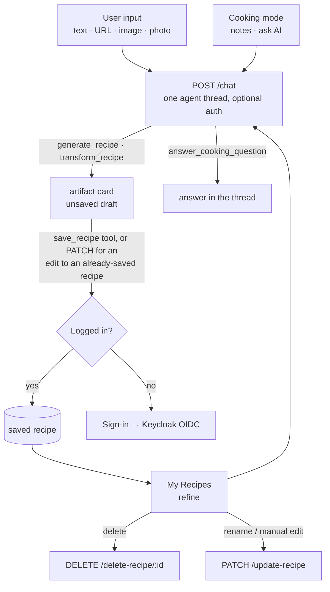
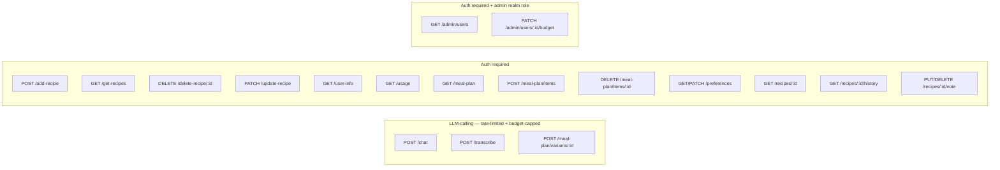

# AGENT.md

This file provides working guidance for the Go backend in this folder — **what exists today**.

> **Where this is going.** The current design gives every capability its own endpoint and its own
> hardcoded prompt (22 prompt literals across 3 files), with four mutually incompatible
> stateless-resend chat protocols and no tool-calling anywhere. The target is a single
> tool-calling agent loop over server-held conversation threads:
> [specs/AGENT_CHAT.md](specs/AGENT_CHAT.md). Ordered work: [../BACKLOG.md](../BACKLOG.md).
> Read both before restructuring `internal/service/`.

## Flows

### User journey

Every AI interaction is a turn on `POST /chat`; the model picks the tool. There is no
review screen (BACKLOG 3.6) and no per-capability AI endpoint left at all — `/generate`
and `/generate/stream` were deleted once they had no client (3.5, 3.9, 3.13).



### API endpoints by auth requirement



> **Rate limiting + budget**: every LLM-calling endpoint goes through `authenticator.Optional`
> first, so `auth.FromContext(r.Context())` returns the caller if a valid token was sent
> (limit/cap by user ID) or nothing for anonymous callers (limit by client IP, no cost
> tracked at all). Each is wrapped `Optional(rl.Guard(billing.Guard(handler)))` in
> `cmd/main.go`, where `rl` is the single `internal/ratelimit` limiter shared by them all
> (`RATE_LIMIT_ANON_PER_10MIN` / `RATE_LIMIT_AUTH_PER_10MIN`, 429 `rate_limited`) — the
> second, more generous limiter died with `/suggest` and `/suggest-prefs` (BACKLOG 3.5).
> `internal/billing` then enforces the caller's monthly spend cap (429 `budget_exceeded`) for authenticated
> callers only — anonymous requests have no cost tracked, so nothing to cap. No other
> `/api/v1` routes are rate-limited or budget-capped.
>
> The 3 `/meal-plan/*` LLM routes share the `generate`/`chat` limiter and go
> through the same `authenticator.Optional` wrapper as every other LLM route, but —
> unlike those — their handlers explicitly 401 an anonymous caller (they operate on the
> caller's own saved recipes, so there's nothing to suggest from without one). An
> anonymous request still consumes one rate-limit slot before hitting that check.

## What This Service Does

Recipe API with:
- anonymous recipe generation (text/url/image)
- authenticated recipe CRUD
- Keycloak JWT auth with just-in-time user provisioning
- PostgreSQL persistence

Current infrastructure status:
- Azure is fully removed from code, dependencies, and runtime.
- MinIO/S3 code paths are removed. PostgreSQL is the only persistence layer.

Main entrypoint: cmd/main.go

## Runbook

From this directory:

```bash
# 1) Start local dependencies (Postgres)
docker compose up -d

# 2) Run API
go run ./cmd/

# 3) Build binary
go build -o main ./cmd/

# 4) Run all tests
go test ./...
```

The server listens on :8080.

## Migrations

Migrations are in db/migrations and managed by goose via Makefile targets:

```bash
make migrate-up
make migrate-down
make migrate-status
make migrate-create NAME=my_migration
```

## Required Environment Variables

Minimum required at startup:
- OPENAI_KEY
- DB_URL
- KEYCLOAK_URL

Optional auth tuning:
- KEYCLOAK_CLIENT_SECRET (enables token introspection)
- KEYCLOAK_BACKEND_CLIENT_ID (default: backend)
- KEYCLOAK_AUDIENCE (enables strict audience check)
- AUTH_INTROSPECT=false (disable introspection even when a secret is set)
- CORS_ORIGIN (must match the browser origin exactly, e.g. http://localhost:8081)
- PORT (default: 8080)

Optional rate limiting + budget tuning (internal/ratelimit, internal/billing):
- One limiter on a rolling 10-minute window, shared by every LLM-calling endpoint
  (chat/transcribe/meal-plan variants).
- RATE_LIMIT_ANON_PER_10MIN (default: 5) / RATE_LIMIT_AUTH_PER_10MIN (default: 15) —
  request cap per client IP / per user ID.
- LLM_BUDGET_DEFAULT_USD (default: 2.00) — monthly per-user spend cap; overridable per
  user via `users.monthly_budget_usd_override` (`PATCH /admin/users/{id}/budget`).
- LLM_TRANSCRIBE_COST_USD (default: 0.003) — flat per-call cost estimate for
  `/transcribe`; the OpenAI SDK call doesn't return audio duration to price it exactly.

Optional OpenTelemetry metrics (internal/telemetry):
- OTEL_ENABLED — must be `true` to turn metrics on at all; unset/false = no-op, safe default
  for local dev. When true, OTEL_EXPORTER_OTLP_ENDPOINT must also be set (Init errors otherwise).
- OTEL_EXPORTER_OTLP_ENDPOINT, OTEL_EXPORTER_OTLP_PROTOCOL (e.g. `http/protobuf`),
  OTEL_EXPORTER_OTLP_HEADERS (e.g. Grafana Cloud's `Authorization=Basic ...`) — standard OTel
  env vars, read directly by the exporter.
- OTEL_SERVICE_NAME (default: recipe-generator-backend)
- Local stack lives in the sibling `../observability/` folder (otel-collector + Prometheus +
  Grafana), not in this repo's docker-compose.yml: `cd ../observability && docker compose up -d`,
  then run the backend with `OTEL_ENABLED=true OTEL_EXPORTER_OTLP_ENDPOINT=http://localhost:4318
  OTEL_EXPORTER_OTLP_PROTOCOL=http/protobuf`. Grafana: http://localhost:3000 (Prometheus
  datasource pre-provisioned). Same env vars point at Grafana Cloud's OTLP endpoint instead when
  you have one.

## Request Flow and Middleware

Server pipeline in cmd/main.go:
- withCORS
- logRequests
- per-route: authenticator.Require(handler) / authenticator.Optional(handler) /
  authenticator.RequireAdmin(handler); the 3 LLM-calling routes additionally wrap with
  `rl.Guard` (internal/ratelimit) and `billing.Guard` (internal/billing), in that order,
  inside the `Optional` call so both see the identified caller.

Auth behavior (internal/auth):
- Bearer token parsed and verified against Keycloak JWKS (RS256 family only).
- Issuer is checked against KEYCLOAK_URL; audience checked when KEYCLOAK_AUDIENCE is set.
- Introspection runs only when a client secret is configured.
- Just-in-time provisioning: on every authenticated request the `sub` claim is upserted into
  `users.oauth_id` (storage.Users.EnsureUser) and the resulting user id is bound to the request
  context via auth.FromContext. No cloud provisioning, no separate login route.
- `IsAdmin` is set from the token's `realm_access.roles` claim (Keycloak realm role
  `admin`, see `../keycloak/terraform/realm.tf`); `RequireAdmin` wraps `Require` with a
  403 for non-admins.

## API Contract (Current)

Base prefix: /api/v1

Public:
- GET /health

LLM-calling — optional auth (identified if a Bearer token is present, anonymous
otherwise), rate-limited and budget-capped per the "Rate limiting + budget" note above:
- POST /transcribe
- POST /chat
	- The agent loop (specs/AGENT_CHAT.md §2). It is the **only** LLM entry point for
	  recipe work: `/refine-recipe` and `/cooking-chat` went in BACKLOG 3.13 (refining is
	  the `transform_recipe` tool, a cooking question is `answer_cooking_question`), and
	  `/generate` + `/generate/stream` went in 3.9 once nothing called them.
	- JSON: `{"conversation_id":"<uuid>"|omitted,"message":"...","language":"de",`
	  `"attachments":[…]}` → `text/event-stream`.
	- `language` is optional (ISO 639-1, the caller's device locale): it is appended to the
	  **system prompt for that turn only**, never stored on the thread, so a thread resumed
	  on another device follows that device. It is the only locale signal the backend has
	  left — the model uses it when the message is too short to detect a language from
	  ("cacio e pepe"), and passes it to `generate_recipe`'s `language` arg.
	- An attachment is either `{"type":"url","url":"…"}` (folded
	  into the message as `[attached link] <url>`; the model decides whether that is a
	  recipe to extract or a page to read) or `{"type":"image","data":"<data: URL or bare
	  base64>"}` — decoded at the handler, refused unless the bytes sniff as an image,
	  parked on the turn's session and announced as `[attached photo] image_ref=imageN`
	  for `generate_recipe`'s `image_ref`. Images are **turn-scoped**: a later turn works
	  from the `draft_ref` the photo produced, not the pixels. Body capped at 12 MiB
	  (base64 inflates by ~4/3) and 3 images per turn. The client sends **one message**, not a transcript: the
	  thread lives server-side (`conversations` / `conversation_messages`, migration
	  00017) for signed-in callers and in-memory with a 2h TTL, keyed by IP like the rate
	  limiter, for anonymous ones. Omit `conversation_id` to start a thread; the id comes
	  back on `event: done`.
	- **Transport is picked from `Accept`**: `application/json` returns one buffered
	  `{"events":[{"type":…,"payload":…},…]}` body when the turn ends — the same events in
	  the same order, for React Native, whose `fetch` has no readable body (BACKLOG 3.8).
	  Anything else streams SSE. The agent loop is identical either way.
	- Events: `token` `{text}` (assistant prose, streamed) · `tool_start` `{name,args}` ·
	  `tool_end` `{name,ok}` · `artifact` `{kind:"recipe"|"week_plan",data}` (the card the
	  client renders inline, and the reason the reply itself does not repeat a recipe) ·
	  `done` `{conversation_id}` · `error` `{code}` — a code, never `err.Error()`.
	  Error codes: `conversation_not_found`, `budget_exceeded`, `iteration_limit`,
	  `timeout`, `model_error`.
	- A draft carries the provenance of the ask that produced it: `toolGenerateRecipe` parks
	  a `GenerationOrigin` on `draftInfo` (it is the only place that still knows whether the
	  user gave a URL, a photo or a description), `transform_recipe` inherits it from its
	  target draft, and `saveDraft` writes it as the recipe's `sources` row.
	- Tool catalog in `internal/service/chat_tools.go`. Two invariants: the user id comes
	  from `auth.FromContext`, never from tool args (a recipe id in args only ever reaches
	  a storage call already scoped to that user, so another user's id is not-found); and
	  every tool returns JSON, never prose. Tools that touch durable per-user state refuse
	  anonymous callers; `generate_recipe`, `fetch_url` and `answer_cooking_question` do
	  not, so the anonymous acquisition funnel still works.
	- `plan_week` only proposes. Applying is **one** `apply_week_plan` call listing every
	  day (`storage.ApplyMealPlanDays` — one transaction, all days or none), which is also
	  the only apply path since the planner UI lost its Accept button (`../BACKLOG.md`
	  4.2/4.3). A proposed day that is a new *variant* recipe exists nowhere yet, so
	  `plan_week` parks each variant as a draft and returns `variant_drafts` (date →
	  `draft_ref`) for `apply_week_plan` to name. Three properties the per-day loop
	  lacked: it is atomic; it is idempotent (saving a draft twice returns the first
	  recipe, and days upsert), so re-applying duplicates nothing; and a day already
	  holding a *different* recipe comes back as
	  `{applied:false, confirm_required:true, would_overwrite:[…]}` instead of being
	  silently replaced — the model shows that list and calls again with `confirm:true`.
	  `set_plan_day` remains for a single day the user named explicitly (same code path,
	  pre-confirmed). Saved variants carry `variant_of_recipe_id` back to their parent.
	- Bounded three ways: `maxTurnIterations` (6) model calls per turn, a 4-minute
	  wall-clock deadline off `r.Context()`, and a budget re-check **between** iterations
	  — an agent turn is N model calls, so a runaway loop trips the cap mid-turn rather
	  than after the whole turn has been paid for. One `llm_usage` row is written per
	  model call in the turn, not per request.
- POST /meal-plan/variants/{recipe_id}
	- optional JSON `{"hint":"make it Thai-style"}` → 200
	  `{"recipename":"...","recipe":"...","structured":<RecipeDocument>,"variant_of_recipe_id":7}`
	  — a new, **unsaved** recipe proposed as a twist on `recipe_id` (which must belong to
	  the caller and have structured data). Persist it via `POST /add-recipe` with
	  `variant_of_recipe_id` set only if the caller accepts it. 404 if the recipe isn't
	  found/owned; 422 if it has no structured data to vary.

Authenticated (Bearer token required):
- GET /user-info
- GET /get-recipes
	- Each recipe carries its provenance read-only: `source_type` (`recipes.source_type`),
	  `source_url` (its first `sources` row, URL saves only) and `created_at` — what the
	  client renders as "From seriouseats.com · 8 Sep" (BACKLOG 3.7). `source_type` is NOT
	  NULL with a `'text'` default, so a bare `'text'` means "nothing was recorded" as often
	  as it means "typed", and the client shows nothing for it.
- POST /add-recipe
	- JSON: `{"recipename":"...","recipe":"...","structured":<RecipeDocument>,`
	  `"origin":{...},"history":[{"change_prompt":"","structured":<RecipeDocument>}, ...],`
	  `"variant_of_recipe_id":7}`
	- **`structured` is required** (400 without it). The untyped branch that wrote a
	  markdown-only recipe with no `RecipeDocument` — the only thing that could create a
	  row cooking mode cannot cook — is gone with `classifyTags`, its only tagger
	  (BACKLOG 3.11). The one remaining client is the meal-plan variant accept path;
	  everything else saves server-side through the agent's `save_recipe` tool.
	- `variant_of_recipe_id` is optional — set when persisting a `POST
	  /meal-plan/variants/{id}` result the caller accepted; stored on `recipes` for
	  grouping, not otherwise surfaced yet.
	- `origin`/`history` are optional. When present (structured saves only), `history[0]`
	  is the initial generation (`change_prompt: ""`); each entry becomes a
	  `recipe_versions` row (`change_kind` `'extraction'` then `'ai_edit'`, `change_note`
	  = the instruction) and a matching `recipe_timeline_events` row, and `origin` is
	  recorded as a `sources` row. `current_version` ends up `len(history)` — so
	  `current_version == 1` means "saved the first generation unedited."
	- 201 with the created recipe
- DELETE /delete-recipe/{id}
	- 204 on success
- PATCH /update-recipe
	- JSON: `{"id":1,"structured":<RecipeDocument>,"ai_sourced":false,"change_prompt":""}` —
	  overwrites the recipe's header, ingredients, steps, and tags with `structured` (tags
	  are always fully replaced, no more "empty tags = unchanged"). `ai_sourced` defaults to
	  `false`; when `false` the recipe is flagged `manually_edited = true`, when `true`
	  (persisting an applied agent refine) the flag is cleared to `false`. Every
	  call also appends one `recipe_versions` snapshot (`change_kind` `'manual'` or
	  `'ai_edit'` to match) and a matching `recipe_timeline_events` row, bumping
	  `current_version` — so a saved recipe's edit trail keeps growing after the initial
	  save, not just during it. `change_prompt` is optional and becomes that version's
	  `change_note`; it's the natural way to persist the AI instruction behind an
	  `ai_sourced` update.
- GET /recipes/{id}
	- 200 with the full recipe (header + structured document). 404 if not owned by the caller.
- PUT /recipes/{id}/vote
	- JSON: `{"vote": 1 | -1}` → the caller's like/dislike on their own recipe
	  (`recipe_votes`, migration `00011`). Surfaced back as `Recipe.my_vote`. Intended as
	  recommendation signal; nothing consumes it yet.
- DELETE /recipes/{id}/vote
	- Clears the caller's vote.
- GET /recipes/{id}/history
	- 200 with `[<RecipeVersion>, ...]`, newest first:
	  `{"version":2,"change_kind":"ai_edit","change_note":"make it vegan","created_at":"...",`
	  `"data":<RecipeDocument>}`. `change_note` is omitted for `"manual"`/`"extraction"`
	  entries with no note. A legacy recipe that predates structured saves returns `[]`
	  (nothing can create one any more — BACKLOG 3.11). 404 if the recipe doesn't exist or
	  isn't owned by the caller.
- GET /usage
	- 200 with `{"spent_usd":...,"cap_usd":...,"period_start":"2026-09-01T00:00:00Z","pct_used":...}`
	  — the caller's own current-calendar-month LLM spend and effective budget cap (their
	  `monthly_budget_usd_override` if set, else `LLM_BUDGET_DEFAULT_USD`). Poll this to
	  show an 80%/100% warning before the caller hits the `budget_exceeded` 429 below.
- GET /meal-plan?starts_on=YYYY-MM-DD&ends_on=YYYY-MM-DD
	- `starts_on` required; `ends_on` optional, defaults to `starts_on+6d` (a week). Range
	  capped at 42 days; 400 if missing/unparseable/out of range.
	- 200 with `{"starts_on":"...","ends_on":"...","items":[{"id":...,"recipe_id":...,`
	  `"recipe_title":"...","planned_on":"...","start_time":"18:00:00"}, ...]}` — every
	  item planned in that range, one recipe per day (`meal_slot` stays at its DB default
	  `'dinner'`; not yet exposed via the API). Used by all three calendar views: Week
	  passes a 7-day range, Day a single day, Month the full displayed grid (up to 42
	  days).
- POST /meal-plan/items
	- JSON: `{"recipe_id":7,"planned_on":"2026-09-09","start_time":"18:00:00"}` →
	  201 with the created item (same shape as one entry in `GET /meal-plan`'s `items`).
	  `start_time` optional, defaults to `18:00:00`. 404 if `recipe_id` doesn't belong to
	  the caller. Upserts by day — replaces whatever was already assigned to `planned_on`,
	  so reassigning a filled day needs no separate delete. Creates that week's
	  `meal_plans` row implicitly on first use.
- PATCH /meal-plan/items/{id}
	- JSON: `{"planned_on":"2026-09-10","start_time":"08:30:00"}` (both required, full
	  replace) → 200 with the updated item. Moves an item to a new day and/or time — the
	  Day view's drag interaction. 404 if the item doesn't exist or isn't owned by the
	  caller.
- DELETE /meal-plan/items/{id}
	- 204 on success, 404 if the item doesn't exist or isn't owned by the caller.
- GET /preferences
	- 200 with `UserPreferences`: `{"skill_level":...,"dietary_prefs":[...],`
	  `"disliked_ingredients":[...],"meal_plan_no_food_days":[...],`
	  `"meal_plan_no_cook_days":[...],"meal_plan_batch_days":1,"week_start_day":"monday"}`.
- PATCH /preferences
	- JSON: full `UserPreferences` (server overwrites, not a merge — always send the
	  complete object). `meal_plan_no_food_days`/`meal_plan_no_cook_days`/
	  `week_start_day` entries validated against `weekdayNames`; `meal_plan_batch_days`
	  must be 1/2/3; a day may not appear in **both** `meal_plan_no_food_days` and
	  `meal_plan_no_cook_days` (400 — the two are contradictory, see BACKLOG 4.4).
	  → 200 with the saved object.

Admin (Bearer token required + `admin` realm role — `internal/auth.RequireAdmin`, 403 for
non-admins):
- GET /admin/users
	- 200 with `[{"id":...,"email":"...","name":"...","spent_usd":...,"cap_usd":...,`
	  `"override_usd":...,"last_seen_at":"..."}, ...]` for every user, most-spent first.
	  `override_usd` is omitted when the user has no override (effective cap is the default).
- PATCH /admin/users/{id}/budget
	- JSON: `{"monthly_budget_usd": 10.0}` (or `null` to clear the override and fall back
	  to the default cap) → 204. 404 if the user doesn't exist.

Notes:
- LLM-calling endpoints return `429` with `{"error":"rate_limited"}` (request cap hit —
  `Retry-After` header included) or `{"error":"budget_exceeded"}` (authenticated caller
  hit their monthly cap) — distinct `error` values so the frontend can tell them apart.
- The historical "service" payload key is gone; the field is "recipe" everywhere.
- Refining a saved recipe (cooking notes, or Refine in the recipes list) is now a `/chat`
  turn naming the recipe id: the agent's `transform_recipe` proposes, and the client
  persists with `PATCH /update-recipe` (`ai_sourced: true`, `change_prompt` set) — so the
  edit trail comes from `recipe_versions`, not from a resent `history` array.
- Ownership always comes from the token subject, never from the request body.

## Data Model

See DATA_MODEL.md for the canonical schema and RECIPE_TAGS.md for the tagging taxonomy.
Migrations `00001`–`00006` create it from scratch; there is no legacy database to preserve.

## Code Map

- cmd/main.go: route registration, handlers for user info/recipes/usage/admin
- cmd/mealplan.go: meal-plan handlers (range get / add / patch / delete item, variants)
- internal/auth: JWKS validation, introspection, JIT user provisioning, admin role, typed request context
- internal/ratelimit: in-memory per-IP/per-user token-bucket request limiter
- internal/billing: LLM cost estimation (pricing.go) and monthly budget enforcement (guard.go)
- internal/llm: the one OpenAI chat-completion call path (`Call[T]` for a decoded value,
  `CallMessage` for the raw assistant message with its tool calls, which is what the agent
  loop iterates on) — every LLM call in the service goes through it, which is what makes cost recording and telemetry unconditional. Also
  owns the prompt files (`prompts/*.txt`, loaded via `go:embed`) and `PromptVersion`, a content
  hash of the prompts that shape a saved `RecipeDocument`.
- internal/service/generate_recipe.go: recipe generation logic (text/url/image), tags and naming
- internal/service/mealplan.go: meal-plan suggestion/chat prompt-building + LLM calls, recipe variant generation — mirrors generate_recipe.go's structured-output pattern
- internal/service/tags.go: fixed recipe tagging vocabulary (`AllTagSlugs`), see specs/RECIPE_TAGS.md
- internal/service/chat.go: the agent loop behind POST /chat — session/thread resolution, SSE
  event emission, iteration/deadline/budget bounds
- internal/service/chat_tools.go: the tool catalog the loop dispatches (specs/AGENT_CHAT.md §2.2)
- internal/service/handlers.go: transcribe + add-recipe handlers
- internal/storage/db.go: pgx pool and recipe queries
- internal/storage/users.go: EnsureUser upsert keyed by OIDC subject
- internal/storage/usage.go: LLM usage recording, spend lookup, admin usage listing, budget overrides
- internal/storage/mealplan.go: meal-plan range queries, transactional upsert-by-day apply
  (`ApplyMealPlanDays`; `AddMealPlanItem` is the one-day case), move (patch), delete
- internal/storage/conversations.go: server-held chat threads for /chat, ownership-checked on
  every read and append
- internal/model/models.go: request/response structs

## Known Constraints and Pitfalls

- **One OpenAI SDK**: `github.com/openai/openai-go` (go.mod). An earlier version of this file
  claimed `sashabaranov/go-openai` was used in parallel — it is not, and appears in no import
  and no `go.sum` line.

- **No tool-calling anywhere.** Every LLM call is a one-shot completion with a JSON-schema
  `ResponseFormat`. `grep -rn "Tools:\|ToolCall\|tool_choice" --include="*.go" .` returns
  nothing. This is the central limitation the agentic-chat rewrite addresses — see
  [specs/AGENT_CHAT.md](specs/AGENT_CHAT.md).

- **One tagger.** The structured schema returns `tags` as a constrained enum. The second
  one (`classifyTags`, a substring match over a plain-text reply) died with
  `/add-recipe`'s untyped branch in BACKLOG 3.11.

- **No generation funnel.** `generation_events` is dropped (migration `00019`, BACKLOG
  3.10/3.14). It only ever had one producer — `/generate` — and `declined`/`refined` lost
  their triggers with the review screen and `/refine-recipe`. Generation and save volume
  come from `telemetry.RecordGenerate`/`RecordSave`; there is no accept-rate metric, and
  re-adding one means instrumenting `/chat`, not reviving the table.

- Recipe content is written as free-form markdown into `recipes.content` (still the field
  the mobile client renders), but for structured saves (`storage.AddRecipeStructured`)
  `recipe_ingredients` / `recipe_steps` / `recipe_versions` / `recipe_timeline_events` /
  `sources` are all populated too. `storage.AddRecipeStructured` is the **only** write
  path left — `storage.AddRecipe`, which skipped all of them, went with `/add-recipe`'s
  untyped branch (BACKLOG 3.11).

- Language detection: `resolveLanguage` in `generate_recipe.go` trusts `lingua-go` detection
  only when the prompt/instructions text is at least 4 words (a short foreign dish name
  shouldn't override the caller's locale); otherwise it falls back to whatever
  `generate_recipe`'s `language` arg carried, or to `""` (LLM self-detects). Since 3.9
  that arg is filled by the **model**, prompted by the `language` on the `/chat` body —
  there is no form field any more, and no other path into `GenerateRecipe`.

- **Introspection requires an audience mapper on every client whose tokens reach this
  backend.** Keycloak 26.x's `/protocol/openid-connect/token/introspect` returns
  `{"active": false}` — not an error — for a perfectly valid, unexpired token if the
  introspecting client (`KEYCLOAK_BACKEND_CLIENT_ID`, i.e. `backend`) isn't present in
  the token's `aud` claim. `frontend` didn't have `backend` in its audience until an
  explicit audience mapper was added (Terraform-managed, see
  `../keycloak/terraform/`). If a new client is ever added (another app, a service,
  etc.) and its calls to auth-required endpoints get an immediate, consistent 401 with
  `introspection done active=false` in the logs — not something that only happens after
  time passes — this is almost certainly the cause: add the same audience mapper for
  that client.

## Editing Guidance

- Prefer small, behavior-preserving changes; this service has production-facing auth and storage side effects.
- When changing endpoints or payload shape, update mobile client calls in recipe-generator-frontend/recipe-generator-mobile/src/services/apiService.ts in the same task.

## Plans and Specs

- [specs/AGENT_CHAT.md](specs/AGENT_CHAT.md) — target architecture: server-held conversation
  threads, a tool catalog, one `internal/llm` call path. **Read this before restructuring
  anything in `internal/service/`.**
- [../BACKLOG.md](../BACKLOG.md) — the ordered implementation work, Phase 0 → 6.
- [specs/DATA_MODEL.md](specs/DATA_MODEL.md) — canonical schema.
- [specs/RECIPE_TAGS.md](specs/RECIPE_TAGS.md) — tagging taxonomy.
- [specs/RECIPE_QUALITY.md](specs/RECIPE_QUALITY.md) /
  [specs/RECIPE_QUALITY_IMPLEMENTATION.md](specs/RECIPE_QUALITY_IMPLEMENTATION.md) — what "good"
  means and the two-model routing. Both carry forward into the agentic design unchanged.
