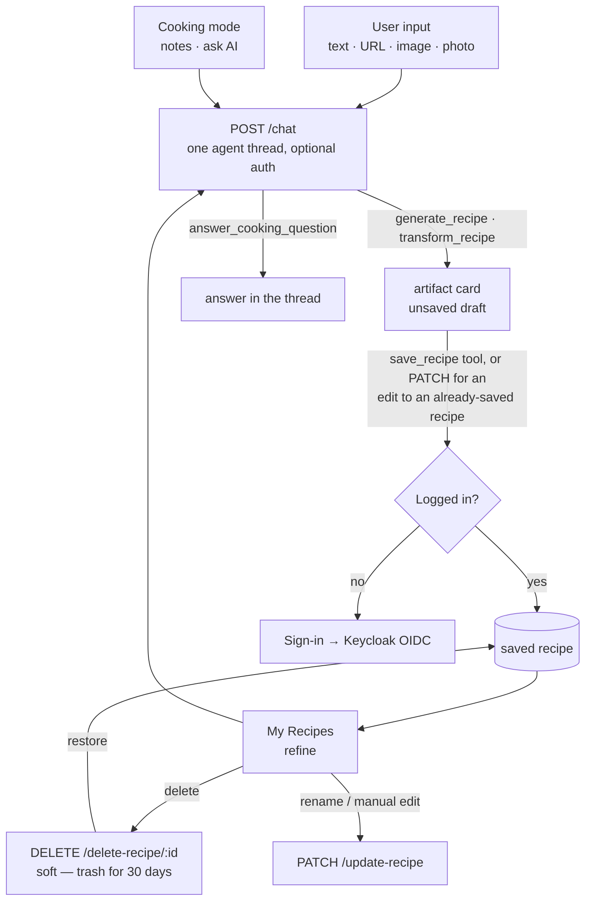

# AGENT.md

This file provides working guidance for the Go backend in this folder — **what exists today**.

> **Where this is going.** The current design gives every capability its own endpoint and its own
> hardcoded prompt (22 prompt literals across 3 files), with four mutually incompatible
> stateless-resend chat protocols and no tool-calling anywhere. The target is a single
> tool-calling agent loop over server-held conversation threads:
> [specs/AGENT_CHAT.md](specs/AGENT_CHAT.md). Ordered work: [../BACKLOG.md](../BACKLOG.md).
> Read both before restructuring `internal/service/`.

## Flows

### User journey

Every AI interaction is a turn on `POST /chat`; the model picks the tool. There is no
review screen (BACKLOG 3.6) and no per-capability AI endpoint left at all — `/generate`
and `/generate/stream` were deleted once they had no client (3.5, 3.9, 3.13).



### API endpoints by auth requirement

```mermaid
graph LR
    subgraph llm["LLM-calling — rate-limited + budget-capped"]
        C[POST /chat]
        T[POST /transcribe]
        MPV[POST /meal-plan/variants/:id]
    end
    subgraph required["Auth required"]
        HH[GET/POST/DELETE /household]
        HHJ[POST /household/join · /leave · /code]
        AR[POST /add-recipe]
        GR[GET /get-recipes]
        DR[DELETE /delete-recipe/:id]
        TR[GET /recipes/trash]
        RS[POST /recipes/:id/restore]
        COL[GET/POST /collections]
        COLD[DELETE /collections/:id]
        COLM[PUT/DELETE /collections/:id/recipes/:recipeId]
        PAN[GET/POST /pantry]
        PAND[DELETE /pantry/:id]
        UR[PATCH /update-recipe]
        UF[GET /user-info]
        US[GET /usage]
        MP[GET /meal-plan]
        MPA[POST /meal-plan/items]
        MPD[DELETE /meal-plan/items/:id]
        MPC[POST/DELETE /meal-plan/items/:id/cooked]
        PR[GET/PATCH /preferences]
        RID[GET /recipes/:id]
        RH[GET /recipes/:id/history]
        V[PUT/DELETE /recipes/:id/vote]
    end
    subgraph admin["Auth required + admin realm role"]
        AU[GET /admin/users]
        AB[PATCH /admin/users/:id/budget]
    end
```



> **Rate limiting + budget**: every LLM-calling endpoint goes through `authenticator.Optional`
> first, so `auth.FromContext(r.Context())` returns the caller if a valid token was sent
> (limit/cap by user ID) or nothing for anonymous callers (limit by client IP, no cost
> tracked at all). Each is wrapped `Optional(rl.Guard(billing.Guard(handler)))` in
> `cmd/main.go`, where `rl` is the single `internal/ratelimit` limiter shared by them all
> (`RATE_LIMIT_ANON_PER_10MIN` / `RATE_LIMIT_AUTH_PER_10MIN`, 429 `rate_limited`) — the
> second, more generous limiter died with `/suggest` and `/suggest-prefs` (BACKLOG 3.5).
> `internal/billing` then enforces the caller's monthly spend cap (429 `budget_exceeded`) for authenticated
> callers only — anonymous requests have no cost tracked, so nothing to cap. No other
> `/api/v1` routes are rate-limited or budget-capped.
>
> The 3 `/meal-plan/*` LLM routes share the `generate`/`chat` limiter and go
> through the same `authenticator.Optional` wrapper as every other LLM route, but —
> unlike those — their handlers explicitly 401 an anonymous caller (they operate on the
> caller's own saved recipes, so there's nothing to suggest from without one). An
> anonymous request still consumes one rate-limit slot before hitting that check.
>
> **`POST /api/v1/feedback` is the one non-LLM route with a limiter** (BACKLOG 9.16), and the
> only optional-auth route whose handler *accepts* an anonymous caller rather than 401ing —
> a tester who never signs in still hits bugs, so the report stores `user_id NULL`. It is
> wrapped `Optional(feedbackRL.Guard(handler))` with its **own** limiter on an hourly window
> (`RATE_LIMIT_FEEDBACK_ANON_PER_HOUR` / `_AUTH_PER_HOUR`), deliberately looser than `rl`:
> the anon budget is per-IP so friends behind one NAT share it, and a rejected request
> spends from it too. No `billing.Guard` — it calls no model. Body capped at 8 MB, because
> an optional screenshot travels inline as base64; the image itself is capped at 5 MB
> (`storage.MaxFeedbackScreenshot`, a 413) and must pass `service.DecodeInlineImage` — the
> same sniffing a `/chat` photo gets, since it is the same trust boundary.

## What This Service Does

Recipe API with:
- anonymous recipe generation (text/url/image)
- authenticated recipe CRUD
- Keycloak JWT auth with just-in-time user provisioning
- PostgreSQL persistence

Current infrastructure status:
- Azure is fully removed from code, dependencies, and runtime.
- MinIO/S3 code paths are removed. PostgreSQL is the only persistence layer.

Main entrypoint: cmd/main.go

## Runbook

From this directory:

```bash
# 1) Start local dependencies (Postgres)
docker compose up -d

# 2) Run API
go run ./cmd/

# 3) Build binary
go build -o main ./cmd/

# 4) Run all tests
go test ./...
```

The server listens on :8080.

## Migrations

Migrations are in db/migrations and managed by goose via Makefile targets:

```bash
make migrate-up
make migrate-down
make migrate-status
make migrate-create NAME=my_migration
```

## Required Environment Variables

Minimum required at startup:
- OPENAI_KEY
- DB_URL
- KEYCLOAK_URL

Optional auth tuning:
- KEYCLOAK_CLIENT_SECRET (enables token introspection)
- KEYCLOAK_BACKEND_CLIENT_ID (default: backend)
- KEYCLOAK_AUDIENCE (enables strict audience check)
- AUTH_INTROSPECT=false (disable introspection even when a secret is set)
- CORS_ORIGIN (must match the browser origin exactly, e.g. http://localhost:8081)
- PORT (default: 8080)

Optional rate limiting + budget tuning (internal/ratelimit, internal/billing):
- One limiter on a rolling 10-minute window, shared by every LLM-calling endpoint
  (chat/transcribe/meal-plan variants).
- RATE_LIMIT_ANON_PER_10MIN (default: 5) / RATE_LIMIT_AUTH_PER_10MIN (default: 15) —
  request cap per client IP / per user ID.
- RATE_LIMIT_FEEDBACK_ANON_PER_HOUR (default: 20) / RATE_LIMIT_FEEDBACK_AUTH_PER_HOUR
  (default: 40) — a separate hourly limiter for `POST /feedback` (BACKLOG 9.16), which is
  a form rather than a model call and so is not sized like one.
- LLM_BUDGET_DEFAULT_USD (default: 2.00) — monthly per-user spend cap; overridable per
  user via `users.monthly_budget_usd_override` (`PATCH /admin/users/{id}/budget`).
- LLM_TRANSCRIBE_COST_USD (default: 0.003) — flat per-call cost estimate for
  `/transcribe`; the OpenAI SDK call doesn't return audio duration to price it exactly.

Optional OpenTelemetry metrics (internal/telemetry):
- OTEL_ENABLED — must be `true` to turn metrics on at all; unset/false = no-op, safe default
  for local dev. When true, OTEL_EXPORTER_OTLP_ENDPOINT must also be set (Init errors otherwise).
- OTEL_EXPORTER_OTLP_ENDPOINT, OTEL_EXPORTER_OTLP_PROTOCOL (e.g. `http/protobuf`),
  OTEL_EXPORTER_OTLP_HEADERS (e.g. Grafana Cloud's `Authorization=Basic ...`) — standard OTel
  env vars, read directly by the exporter.
- OTEL_SERVICE_NAME (default: recipe-generator-backend)
- Local stack lives in the sibling `../observability/` folder (otel-collector + Prometheus +
  Grafana), not in this repo's docker-compose.yml: `cd ../observability && docker compose up -d`,
  then run the backend with `OTEL_ENABLED=true OTEL_EXPORTER_OTLP_ENDPOINT=http://localhost:4318
  OTEL_EXPORTER_OTLP_PROTOCOL=http/protobuf`. Grafana: http://localhost:3000 (Prometheus
  datasource pre-provisioned). Same env vars point at Grafana Cloud's OTLP endpoint instead when
  you have one.

## Request Flow and Middleware

Server pipeline in cmd/main.go:
- withCORS
- logRequests
- per-route: authenticator.Require(handler) / authenticator.Optional(handler) /
  authenticator.RequireAdmin(handler); the 3 LLM-calling routes additionally wrap with
  `rl.Guard` (internal/ratelimit) and `billing.Guard` (internal/billing), in that order,
  inside the `Optional` call so both see the identified caller.

Auth behavior (internal/auth):
- Bearer token parsed and verified against Keycloak JWKS (RS256 family only).
- Issuer is checked against KEYCLOAK_URL; audience checked when KEYCLOAK_AUDIENCE is set.
- Introspection runs only when a client secret is configured.
- Just-in-time provisioning: on every authenticated request the `sub` claim is upserted into
  `users.oauth_id` (storage.Users.EnsureUser) and the resulting user id is bound to the request
  context via auth.FromContext. No cloud provisioning, no separate login route.
- `IsAdmin` is set from the token's `realm_access.roles` claim (Keycloak realm role
  `admin`, see `../keycloak/terraform/realm.tf`); `RequireAdmin` wraps `Require` with a
  403 for non-admins.

## API Contract

The full endpoint contract (request/response shapes, SSE events, approval flow, rate limits) lives in [specs/API_CONTRACT.md](specs/API_CONTRACT.md). **Read it before changing or calling an endpoint**; the auth-grouped route list under "Flows" above is the quick map.

## Data Model

> **Households (BACKLOG 15.1).** `00035` adds a `households` table and a nullable `household_id`
> to `users`, `recipes`, `pantry_items` and `meal_plans` — `ON DELETE SET NULL` on every one,
> never CASCADE, because dropping a household must orphan rows back to their owners rather than
> destroy a member's recipes. Membership is a column on `users`, not a join table: a user is in
> at most one household. **Nothing is re-owned** — `user_id` still records who made every row,
> which is the single property the leave/disband contract rests on. `pantry_items`' uniqueness
> moved from `(user_id, …)` to `(COALESCE(household_id::text, 'u' || user_id), …)`, so one
> household is one fridge with one flour line. `collections` deliberately got none.
>
> **`specs/DATA_MODEL.md` is stale** and predates most of this — it still documents `meal_plans`
> override columns dropped in `00018` and `meal_plan_items.start_time` dropped in `00028`, and
> has no `pantry_items`, `conversations` or `user_cooking_profiles`. Read the migrations.

See DATA_MODEL.md for the canonical schema and RECIPE_TAGS.md for the tagging taxonomy.
Migrations `00001`–`00006` create it from scratch; there is no legacy database to preserve.
`00020` adds `collections` + `recipe_collections` (BACKLOG 8.1); `00026` adds `pantry_items`
(BACKLOG 7.1); `00036` adds `pantry_items.staple`, `meal_plan_items.cooked_at` and
`ingredient_grams` (BACKLOG 16). `00040` teaches `normalize_item()` to strip a leading size
word and `00041` adds `ingredient_alias` + `canonical_item()` + `pg_trgm` (BACKLOG 17).
`recipes.deleted_at` has existed since `00001` but only became meaningful with BACKLOG 8.2's
soft delete.

## Code Map

- cmd/main.go: route registration, handlers for user info/recipes/usage/admin
- cmd/mealplan.go: meal-plan handlers (range get / add / patch / delete item, variants)
- cmd/backfill-aisles: one-off `make backfill-aisles` — classifies pre-BACKLOG-6.1
  ingredients into shopping aisles, one `choice` question per item on the **Decisions API**
  (`llm.Decide`, `POST /v1/decisions`, `gpt-6-luna`); answers under 0.6 confidence stay NULL
  for the next run. Re-running with nothing NULL costs nothing
- cmd/backfill-grams: the same shape for `ingredient_grams` (BACKLOG 16.2) — resolves every
  (item, unit) in use that nothing can convert yet. Live saves resolve their own
  (`service.LearnGrams`), so this is for the library that predates them. Safe to re-run, and
  re-running **is** the retry: a pair the model dropped was never written, so it is still on
  the worklist
- cmd/backfill-aliases: the same shape again for `ingredient_alias` (BACKLOG 17.2) — resolves
  every food in use that has no canonical name yet. **Run it before `backfill-grams` on a cold
  database**, so each food is weighed once rather than once per language it was written in
- internal/auth: JWKS validation, introspection, JIT user provisioning, admin role, typed request context
- internal/ratelimit: in-memory per-IP/per-user token-bucket request limiter
- internal/worker: the periodic background pass — cooking-profile recompute, and purging
  recipes trashed longer than 30 days
- internal/billing: LLM cost estimation (pricing.go) and monthly budget enforcement (guard.go)
- internal/llm: the one OpenAI chat-completion call path (`Call[T]` for a decoded value,
  `CallMessage` for the raw assistant message with its tool calls, which is what the agent
  loop iterates on) — every LLM call in the service goes through it, which is what makes cost recording and telemetry unconditional. Also
  owns the prompt files (`prompts/*.txt`, loaded via `go:embed`) and `PromptVersion`, a content
  hash of the prompts that shape a saved `RecipeDocument`. `Decide` is the second path: typed
  classification over `POST /v1/decisions` (raw `client.Post` — openai-go v1 predates it),
  recorded through the same cost and telemetry calls.
- internal/service/generate_recipe.go: recipe generation logic (text/url/image), tags and naming
- internal/service/mealplan.go: meal-plan suggestion/chat prompt-building + LLM calls, recipe variant generation — mirrors generate_recipe.go's structured-output pattern
- internal/service/tags.go: fixed recipe tagging vocabulary (`AllTagSlugs`), see specs/RECIPE_TAGS.md
- internal/service/chat.go: the agent loop behind POST /chat — session/thread resolution, SSE
  event emission, iteration/deadline/budget bounds
- internal/service/calculators.go + seasonal.go + kitchen_tools.go: the kitchen tools (BACKLOG 19.1) — pure calculators
  (`calcCatalog`, rendered as forms by the Tools screen), the Germany-only seasonal table, the three public `/tools` handlers
  and the `calculate` / `seasonal` agent tools. No DB, no model
- internal/service/chat_tools.go: the tool catalog the loop dispatches (specs/AGENT_CHAT.md §2.2)
- internal/service/handlers.go: transcribe + add-recipe handlers
- internal/storage/db.go: pgx pool and recipe queries
- internal/storage/users.go: EnsureUser upsert keyed by OIDC subject, preferences read/write
  (two of which are household-wide, see `/preferences`), and `KitchenDietary` — the union of
  every member's dislikes and dietary prefs, which is what `plan_week` must plan against
- internal/storage/households.go: households (BACKLOG 15.1) — create, join by code, leave,
  disband, rotate the code. Holds the **exit contract**: recipes and pantry items revert to the
  `user_id` they never stopped carrying, planned days after today are deleted and earlier ones
  kept, and a leaver's plan rows change hands so the week does not survive as nobody's
- internal/storage/scope.go: the **one** scope predicate (`inScope`) and the household stamp on
  writes. A row is in scope when it carries the caller's household_id, or carries none and the
  caller owns it — which for a caller with no household collapses to the plain `user_id` check
  this code did before. **The whole feature is inert until somebody creates a household**, which
  is what made it safe to ship against live data. Also `kitchenOwner`, which decides whose
  personal settings stand for the whole kitchen
- internal/storage/usage.go: LLM usage recording, spend lookup, admin usage listing, budget overrides
- internal/storage/mealplan.go: meal-plan range queries, transactional upsert-by-day apply
  (`ApplyMealPlanDays`; `AddMealPlanItem` is the one-day case), move (patch), delete, and
  `SetBatchCook` — one cooking day covering a set of later days (BACKLOG 9.13).
  `SetBatchCook` deliberately does **not** go through `ApplyMealPlanDays`: that upserts by
  deleting the existing row first, and deleting a cook cascades away the very leftovers it
  would be writing
- internal/storage/collections.go: collections CRUD and membership, every query scoped by
  `user_id` so another user's id is not-found (BACKLOG 8.1)
- internal/storage/pantry.go: pantry CRUD (BACKLOG 7.1) and `RecipesUsingIngredients`, the
  "what can I cook before it goes off" lookup behind `search_my_recipes`'s `ingredients`
  filter (7.4). The pantry match itself (7.3) is two columns on `GetRecipes`, not a
  function here — it has no caller that wants it separately. Also `StapleNames` (16.1) and
  `DeductPantry` (16.3), which takes what a cooked recipe used out of the fridge **inside the
  caller's transaction** and skips — never estimates — anything it cannot convert
- internal/storage/grams.go: the `ingredient_grams` conversion table (BACKLOG 16.2). The one
  table in this package with no `inScope` and no userID, deliberately: how much an onion
  weighs is not a fact about a household
- internal/storage/cooked_meal.go: `MarkMealCooked` / `UnmarkMealCooked` (16.3) — one
  transaction stamping `meal_plan_items.cooked_at`, `recipes.last_cooked_at` and the pantry
  deduction together. `PreviewDeductPantry` is the same call in a transaction that is always
  rolled back, which is what the agent's approval card shows
- internal/service/grams.go: filling `ingredient_grams` from the assist model
  (`EnsureGrams`), and `LearnGrams`, the detached version every recipe save fires
- internal/storage/alias.go + internal/service/alias.go: the same pattern for
  `ingredient_alias` (BACKLOG 17.2) — `EnsureAliases` / `LearnAliases` / `NearestCanonical`.
  `grams.go` is the template and the resemblance is deliberate: same batch size, same
  echo-the-key-back join, same `DO NOTHING`, same detachment
- internal/storage/video_transcripts.go: the transcript cache behind `videoTranscript`
  (BACKLOG 11.9, migration `00047`). Global and userID-free for `grams.go`'s reason — a public
  reel's soundtrack is not a fact about a household. Keyed on the Instagram **shortcode**, so
  the several URL shapes of one reel are one entry, and the read reports `found` separately
  from the text because a silent reel's `""` is an answer worth caching
- internal/storage/duplicates.go: the advisory, time-capped duplicate lookup behind
  `save_recipe`'s prompt (BACKLOG 8.3)
- internal/storage/conversations.go: server-held chat threads for /chat, ownership-checked on
  every read and append
- internal/model/models.go: request/response structs

## Known Constraints and Pitfalls

- **One OpenAI SDK**: `github.com/openai/openai-go` (go.mod). An earlier version of this file
  claimed `sashabaranov/go-openai` was used in parallel — it is not, and appears in no import
  and no `go.sum` line.

- **No tool-calling anywhere.** Every LLM call is a one-shot completion with a JSON-schema
  `ResponseFormat`. `grep -rn "Tools:\|ToolCall\|tool_choice" --include="*.go" .` returns
  nothing. This is the central limitation the agentic-chat rewrite addresses — see
  [specs/AGENT_CHAT.md](specs/AGENT_CHAT.md).

- **`NormalizeItem` drops the preparation, and is load-bearing in four places.** It cuts at
  the first comma or bracket and lowercases the rest, so `onion`, `onion, sliced` and
  `onion (chopped)` are one food to the pantry match, the grocery list, `ingredient_grams`
  and the cooked deduction (BACKLOG 16.4). `recipe_ingredients.item` still holds the full
  text and is still what renders — only the *key* is the bare food. **There are two copies
  of this rule**: `model.NormalizeItem` and the SQL `normalize_item()` from migration
  `00037`, which every storage query calls. Change one, change both — `internal/model/grams_test.go`
  pins the cases. **Since BACKLOG 17.1 it also drops a leading size word** (`medium onion` is
  `onion`), and the weight that word implies moves into `model.SplitSize`'s factor, which
  `ToGrams` applies to whole pieces only. `TestMigrationSizeWordsMatchGo` fails if the Go list
  and migration `00040`'s SQL alternation drift apart.

- **`ToGrams` must be given the ingredient's ORIGINAL wording, not a pre-normalised key.**
  The size modifier lives in that text and `ToGrams` reads it there; passing an already
  normalised name silently yields a factor of 1. This was a real bug in 17.1 — `consolidate`
  and `DeductPantry` both did it, and the feature worked only in unit tests. They now carry
  the written text to the weighing step (`measured.entries[].item`, `rawNeed.written`) while
  the group key stays the bare food. `TestGroceryListWeighsSizedIngredients` pins it.

- **`canonical` merges, `class` does not, and the difference is the whole of `ingredient_alias`.**
  `canonical` is the same food under another name (`zwiebel` → `onion`) and is safe to merge in
  the pantry match, the grocery list and the deduction — that is what `canonical_item()` does at
  every join. `class` is a food you could *substitute* (`spaghetti`/`penne` → `pasta_dry`) and
  must never reach any of them: a pantry that quietly claimed to hold spaghetti would send
  someone to the kitchen with the wrong box. `TestPantryMatchUsesCanonicalNotClass` pins both
  halves, and BACKLOG 17.4 is the only thing allowed to read `class`.

- **Grams are keyed per language, aliases are not.** `zwiebel → 150` and `onion → 150` are the
  same answer stored twice, deliberately: it costs one nano call and avoids threading an alias
  map through `ToGrams`' signature at every call site. Canonical governs matching and grouping,
  never weighing.

- **One tagger.** The structured schema returns `tags` as a constrained enum. The second
  one (`classifyTags`, a substring match over a plain-text reply) died with
  `/add-recipe`'s untyped branch in BACKLOG 3.11.

- **No generation funnel.** `generation_events` is dropped (migration `00019`, BACKLOG
  3.10/3.14). It only ever had one producer — `/generate` — and `declined`/`refined` lost
  their triggers with the review screen and `/refine-recipe`. Generation and save volume
  come from `telemetry.RecordGenerate`/`RecordSave`; there is no accept-rate metric, and
  re-adding one means instrumenting `/chat`, not reviving the table.

- Recipe content is written as free-form markdown into `recipes.content` (still the field
  the mobile client renders), but for structured saves (`storage.AddRecipeStructured`)
  `recipe_ingredients` / `recipe_steps` / `recipe_versions` / `recipe_timeline_events` /
  `sources` are all populated too. `storage.AddRecipeStructured` is the **only** write
  path left — `storage.AddRecipe`, which skipped all of them, went with `/add-recipe`'s
  untyped branch (BACKLOG 3.11).

- Language detection: `resolveLanguage` in `generate_recipe.go` trusts `lingua-go` detection
  only when the prompt/instructions text is at least 4 words (a short foreign dish name
  shouldn't override the caller's locale); otherwise it falls back to whatever
  `generate_recipe`'s `language` arg carried, or to `""` (LLM self-detects). Since 3.9
  that arg is filled by the **model**, prompted by the `language` on the `/chat` body —
  there is no form field any more, and no other path into `GenerateRecipe`.

- **Introspection requires an audience mapper on every client whose tokens reach this
  backend.** Keycloak 26.x's `/protocol/openid-connect/token/introspect` returns
  `{"active": false}` — not an error — for a perfectly valid, unexpired token if the
  introspecting client (`KEYCLOAK_BACKEND_CLIENT_ID`, i.e. `backend`) isn't present in
  the token's `aud` claim. `frontend` didn't have `backend` in its audience until an
  explicit audience mapper was added (Terraform-managed, see
  `../keycloak/terraform/`). If a new client is ever added (another app, a service,
  etc.) and its calls to auth-required endpoints get an immediate, consistent 401 with
  `introspection done active=false` in the logs — not something that only happens after
  time passes — this is almost certainly the cause: add the same audience mapper for
  that client.

## Editing Guidance

- Prefer small, behavior-preserving changes; this service has production-facing auth and storage side effects.
- When changing endpoints or payload shape, update mobile client calls in recipe-generator-frontend/recipe-generator-mobile/src/services/apiService.ts in the same task.

## Plans and Specs

- [specs/AGENT_CHAT.md](specs/AGENT_CHAT.md) — target architecture: server-held conversation
  threads, a tool catalog, one `internal/llm` call path. **Read this before restructuring
  anything in `internal/service/`.**
- [../BACKLOG.md](../BACKLOG.md) — the ordered implementation work, Phase 0 → 6.
- [specs/DATA_MODEL.md](specs/DATA_MODEL.md) — canonical schema.
- [specs/RECIPE_TAGS.md](specs/RECIPE_TAGS.md) — tagging taxonomy.
- [specs/RECIPE_QUALITY.md](specs/RECIPE_QUALITY.md) /
  [specs/RECIPE_QUALITY_IMPLEMENTATION.md](specs/RECIPE_QUALITY_IMPLEMENTATION.md) — what "good"
  means and the two-model routing. Both carry forward into the agentic design unchanged.
