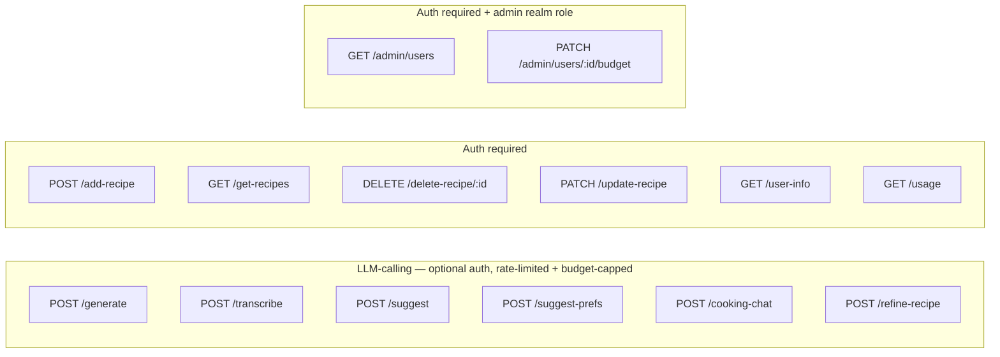

# AGENT.md

This file provides working guidance for the Go backend in this folder.

## Flows

### User journey

```mermaid
flowchart TD
    INPUT[User input\ntext · URL · image] --> GEN[POST /generate]
    GEN --> REVIEW[Review Screen\nStructured recipe + single chat pane]

    REVIEW -->|chat message\ne.g. "remove garlic" · "make it vegan"| REFINE[POST /refine-recipe\noptional auth]
    REFINE --> REVIEW

    REVIEW -->|save| AUTH{Logged in?}
    AUTH -->|yes| SAVE[POST /add-recipe]
    AUTH -->|no| LOGIN[Sign-in → Keycloak OIDC]
    SAVE --> MYRECIPES[My Recipes]

    MYRECIPES -->|refine saved recipe| REFINE
    MYRECIPES -->|delete| DEL[DELETE /delete-recipe/:id]
    MYRECIPES -->|rename / manual edit| PATCH[PATCH /update-recipe]
```

### API endpoints by auth requirement



> **Rate limiting + budget**: all 6 LLM-calling endpoints go through `authenticator.Optional`
> first, so `auth.FromContext(r.Context())` returns the caller if a valid token was sent
> (limit/cap by user ID) or nothing for anonymous callers (limit by client IP, no cost
> tracked at all). Each is wrapped `Optional(rl.Guard(billing.Guard(handler)))` in
> `cmd/main.go`: `internal/ratelimit` enforces `RATE_LIMIT_ANON_PER_HOUR` /
> `RATE_LIMIT_AUTH_PER_HOUR` (429 `rate_limited`), then `internal/billing` enforces the
> caller's monthly spend cap (429 `budget_exceeded`) for authenticated callers only —
> anonymous requests have no cost tracked, so nothing to cap. No other `/api/v1` routes
> are rate-limited or budget-capped.

## What This Service Does

Recipe API with:
- anonymous recipe generation (text/url/image)
- authenticated recipe CRUD
- Keycloak JWT auth with just-in-time user provisioning
- PostgreSQL persistence

Current infrastructure status:
- Azure is fully removed from code, dependencies, and runtime.
- MinIO/S3 code paths are removed. PostgreSQL is the only persistence layer.

Main entrypoint: cmd/main.go

## Runbook

From this directory:

```bash
# 1) Start local dependencies (Postgres)
docker compose up -d

# 2) Run API
go run ./cmd/

# 3) Build binary
go build -o main ./cmd/

# 4) Run all tests
go test ./...
```

The server listens on :8080.

## Migrations

Migrations are in db/migrations and managed by goose via Makefile targets:

```bash
make migrate-up
make migrate-down
make migrate-status
make migrate-create NAME=my_migration
```

## Required Environment Variables

Minimum required at startup:
- OPENAI_KEY
- DB_URL
- KEYCLOAK_URL

Optional auth tuning:
- KEYCLOAK_CLIENT_SECRET (enables token introspection)
- KEYCLOAK_BACKEND_CLIENT_ID (default: backend)
- KEYCLOAK_AUDIENCE (enables strict audience check)
- AUTH_INTROSPECT=false (disable introspection even when a secret is set)
- CORS_ORIGIN (must match the browser origin exactly, e.g. http://localhost:8081)
- PORT (default: 8080)

Optional rate limiting + budget tuning (internal/ratelimit, internal/billing):
- RATE_LIMIT_ANON_PER_HOUR (default: 5) — anonymous request cap per client IP, LLM
  endpoints only.
- RATE_LIMIT_AUTH_PER_HOUR (default: 60) — authenticated request cap per user ID.
- LLM_BUDGET_DEFAULT_USD (default: 2.00) — monthly per-user spend cap; overridable per
  user via `users.monthly_budget_usd_override` (`PATCH /admin/users/{id}/budget`).
- LLM_TRANSCRIBE_COST_USD (default: 0.003) — flat per-call cost estimate for
  `/transcribe`; the OpenAI SDK call doesn't return audio duration to price it exactly.

Optional OpenTelemetry metrics (internal/telemetry):
- OTEL_ENABLED — must be `true` to turn metrics on at all; unset/false = no-op, safe default
  for local dev. When true, OTEL_EXPORTER_OTLP_ENDPOINT must also be set (Init errors otherwise).
- OTEL_EXPORTER_OTLP_ENDPOINT, OTEL_EXPORTER_OTLP_PROTOCOL (e.g. `http/protobuf`),
  OTEL_EXPORTER_OTLP_HEADERS (e.g. Grafana Cloud's `Authorization=Basic ...`) — standard OTel
  env vars, read directly by the exporter.
- OTEL_SERVICE_NAME (default: recipe-generator-backend)
- Local stack lives in the sibling `../observability/` folder (otel-collector + Prometheus +
  Grafana), not in this repo's docker-compose.yml: `cd ../observability && docker compose up -d`,
  then run the backend with `OTEL_ENABLED=true OTEL_EXPORTER_OTLP_ENDPOINT=http://localhost:4318
  OTEL_EXPORTER_OTLP_PROTOCOL=http/protobuf`. Grafana: http://localhost:3000 (Prometheus
  datasource pre-provisioned). Same env vars point at Grafana Cloud's OTLP endpoint instead when
  you have one.

## Request Flow and Middleware

Server pipeline in cmd/main.go:
- withCORS
- logRequests
- per-route: authenticator.Require(handler) / authenticator.Optional(handler) /
  authenticator.RequireAdmin(handler); the 6 LLM-calling routes additionally wrap with
  `rl.Guard` (internal/ratelimit) and `billing.Guard` (internal/billing), in that order,
  inside the `Optional` call so both see the identified caller.

Auth behavior (internal/auth):
- Bearer token parsed and verified against Keycloak JWKS (RS256 family only).
- Issuer is checked against KEYCLOAK_URL; audience checked when KEYCLOAK_AUDIENCE is set.
- Introspection runs only when a client secret is configured.
- Just-in-time provisioning: on every authenticated request the `sub` claim is upserted into
  `users.oauth_id` (storage.Users.EnsureUser) and the resulting user id is bound to the request
  context via auth.FromContext. No cloud provisioning, no separate login route.
- `IsAdmin` is set from the token's `realm_access.roles` claim (Keycloak realm role
  `admin`, see `../keycloak/terraform/realm.tf`); `RequireAdmin` wraps `Require` with a
  403 for non-admins.

## API Contract (Current)

Base prefix: /api/v1

Public:
- GET /health

LLM-calling — optional auth (identified if a Bearer token is present, anonymous
otherwise), rate-limited and budget-capped per the "Rate limiting + budget" note above:
- POST /generate
	- multipart form
	- fields: description (text), url, image, language (optional, ISO 639-1, e.g. "en" —
	  client's browser/device locale, used as the default output language when the prompt
	  doesn't carry a clear language signal of its own; see "Language detection" below)
- POST /transcribe, POST /suggest, POST /suggest-prefs, POST /cooking-chat
- POST /refine-recipe
	- JSON: `{"origin":{"prompt":"...","source_type":"text|url|image","source_url":"..."},`
	  `"initial":<RecipeDocument>,"history":[{"change_prompt":"...","structured":<RecipeDocument>}],`
	  `"change_prompt":"..."}`
	- Threads the whole conversation (original ask → initial doc → every prior accepted
	  edit → the new instruction) into one multi-turn LLM call, so each edit stays
	  consistent with everything before it. `history` is the edits since `initial`,
	  oldest first — it does NOT include `initial` itself.

Authenticated (Bearer token required):
- GET /user-info
- GET /get-recipes
- POST /add-recipe
	- JSON: `{"recipename":"...","recipe":"...","tags":["..."],"structured":<RecipeDocument>,`
	  `"origin":{...},"history":[{"change_prompt":"","structured":<RecipeDocument>}, ...]}`
	- `origin`/`history` are optional. When present (structured saves only), `history[0]`
	  is the initial generation (`change_prompt: ""`); each entry becomes a
	  `recipe_versions` row (`change_kind` `'extraction'` then `'ai_edit'`, `change_note`
	  = the instruction) and a matching `recipe_timeline_events` row, and `origin` is
	  recorded as a `sources` row. `current_version` ends up `len(history)` — so
	  `current_version == 1` means "saved the first generation unedited."
	- 201 with the created recipe
- DELETE /delete-recipe/{id}
	- 204 on success
- PATCH /update-recipe
	- JSON: `{"id":1,"structured":<RecipeDocument>,"ai_sourced":false,"change_prompt":""}` —
	  overwrites the recipe's header, ingredients, steps, and tags with `structured` (tags
	  are always fully replaced, no more "empty tags = unchanged"). `ai_sourced` defaults to
	  `false`; when `false` the recipe is flagged `manually_edited = true`, when `true`
	  (persisting an applied `/refine-recipe` result) the flag is cleared to `false`. Every
	  call also appends one `recipe_versions` snapshot (`change_kind` `'manual'` or
	  `'ai_edit'` to match) and a matching `recipe_timeline_events` row, bumping
	  `current_version` — so a saved recipe's edit trail keeps growing after the initial
	  save, not just during it. `change_prompt` is optional and becomes that version's
	  `change_note`; it's the natural way to persist the AI instruction behind an
	  `ai_sourced` update.
- POST /update-recipe
	- JSON: {"recipe":"...","changePrompt":"..."}
- GET /recipes/{id}/history
	- 200 with `[<RecipeVersion>, ...]`, newest first:
	  `{"version":2,"change_kind":"ai_edit","change_note":"make it vegan","created_at":"...",`
	  `"data":<RecipeDocument>}`. `change_note` is omitted for `"manual"`/`"extraction"`
	  entries with no note. A recipe that's never had a structured save (markdown-only
	  `add-recipe`, no `structured` field) returns `[]`. 404 if the recipe doesn't exist or
	  isn't owned by the caller.
- GET /usage
	- 200 with `{"spent_usd":...,"cap_usd":...,"period_start":"2026-09-01T00:00:00Z","pct_used":...}`
	  — the caller's own current-calendar-month LLM spend and effective budget cap (their
	  `monthly_budget_usd_override` if set, else `LLM_BUDGET_DEFAULT_USD`). Poll this to
	  show an 80%/100% warning before the caller hits the `budget_exceeded` 429 below.

Admin (Bearer token required + `admin` realm role — `internal/auth.RequireAdmin`, 403 for
non-admins):
- GET /admin/users
	- 200 with `[{"id":...,"email":"...","name":"...","spent_usd":...,"cap_usd":...,`
	  `"override_usd":...,"last_seen_at":"..."}, ...]` for every user, most-spent first.
	  `override_usd` is omitted when the user has no override (effective cap is the default).
- PATCH /admin/users/{id}/budget
	- JSON: `{"monthly_budget_usd": 10.0}` (or `null` to clear the override and fall back
	  to the default cap) → 204. 404 if the user doesn't exist.

Notes:
- LLM-calling endpoints return `429` with `{"error":"rate_limited"}` (request cap hit —
  `Retry-After` header included) or `{"error":"budget_exceeded"}` (authenticated caller
  hit their monthly cap) — distinct `error` values so the frontend can tell them apart.
- The historical "service" payload key is gone; the field is "recipe" everywhere.
- Refining/saving an already-saved recipe (CookingModeScreen, "cooking notes" flow) does
  not use `origin`/`history` — that path stays a single-turn refine with no persisted
  edit trail. Only the pre-save GenerateScreen review chat does.
- Ownership always comes from the token subject, never from the request body.

## Data Model

See DATA_MODEL.md for the canonical schema and RECIPE_TAGS.md for the tagging taxonomy.
Migrations `00001`–`00006` create it from scratch; there is no legacy database to preserve.

## Code Map

- cmd/main.go: route registration, handlers for user info/recipes/usage/admin
- internal/auth: JWKS validation, introspection, JIT user provisioning, admin role, typed request context
- internal/ratelimit: in-memory per-IP/per-user token-bucket request limiter
- internal/billing: LLM cost estimation (pricing.go) and monthly budget enforcement (guard.go)
- internal/service/generate_recipe.go: recipe generation logic (text/url/image), tags and naming
- internal/service/tags.go: fixed recipe tagging vocabulary (`AllTagSlugs`), see specs/RECIPE_TAGS.md
- internal/service/handlers.go: generate + add handlers, shared LLM cost-recording helper
- internal/storage/db.go: pgx pool and recipe queries
- internal/storage/users.go: EnsureUser upsert keyed by OIDC subject
- internal/storage/usage.go: LLM usage recording, spend lookup, admin usage listing, budget overrides
- internal/model/models.go: request/response structs

## Known Constraints and Pitfalls

- Two OpenAI SDKs are used in parallel:
	- github.com/openai/openai-go
	- github.com/sashabaranov/go-openai
	Keep existing usage consistent unless doing a dedicated migration.

- Unused guard exists:
	- HandlerIsRecipeRelated is not wired to active routes.

- Recipe content is written as free-form markdown into `recipes.content` (still the field
  the mobile client renders), but for structured saves (`storage.AddRecipeStructured`)
  `recipe_ingredients` / `recipe_steps` / `recipe_versions` / `recipe_timeline_events` /
  `sources` are all populated too — only the plain-markdown `storage.AddRecipe` path
  (no `structured` field) skips them.

- Language detection (text-generation path only): `resolveLanguage` in `generate_recipe.go`
  trusts `lingua-go` detection only when the prompt is at least 4 words (a short foreign dish
  name shouldn't override the client's browser locale); otherwise it falls back to the
  `language` form field sent by the client, or to `""` (LLM self-detects) for older clients that
  don't send it.

- **Introspection requires an audience mapper on every client whose tokens reach this
  backend.** Keycloak 26.x's `/protocol/openid-connect/token/introspect` returns
  `{"active": false}` — not an error — for a perfectly valid, unexpired token if the
  introspecting client (`KEYCLOAK_BACKEND_CLIENT_ID`, i.e. `backend`) isn't present in
  the token's `aud` claim. `frontend` didn't have `backend` in its audience until an
  explicit audience mapper was added (Terraform-managed, see
  `../keycloak/terraform/`). If a new client is ever added (another app, a service,
  etc.) and its calls to auth-required endpoints get an immediate, consistent 401 with
  `introspection done active=false` in the logs — not something that only happens after
  time passes — this is almost certainly the cause: add the same audience mapper for
  that client.

## Editing Guidance

- Prefer small, behavior-preserving changes; this service has production-facing auth and storage side effects.
- When changing endpoints or payload shape, update mobile client calls in recipe-generator-frontend/recipe-generator-mobile/src/services/apiService.ts in the same task.

## Refactor Plans

- API/auth/CRUD plan: ../REFACTOR_PLAN_API_AUTH_CRUD.md
- Backend implementation plan (includes OAS strategy): REFACTOR_PLAN.md
