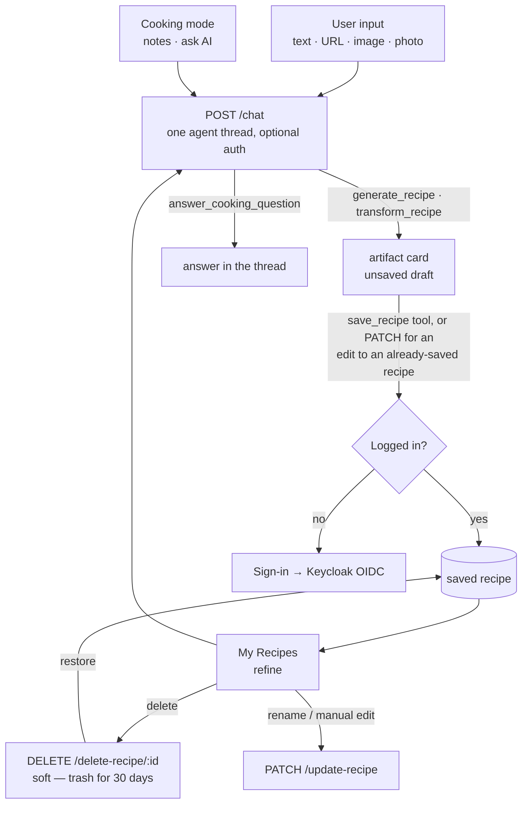

# AGENT.md

This file provides working guidance for the Go backend in this folder — **what exists today**.

> **Where this is going.** The current design gives every capability its own endpoint and its own
> hardcoded prompt (22 prompt literals across 3 files), with four mutually incompatible
> stateless-resend chat protocols and no tool-calling anywhere. The target is a single
> tool-calling agent loop over server-held conversation threads:
> [specs/AGENT_CHAT.md](specs/AGENT_CHAT.md). Ordered work: [../BACKLOG.md](../BACKLOG.md).
> Read both before restructuring `internal/service/`.

## Flows

### User journey

Every AI interaction is a turn on `POST /chat`; the model picks the tool. There is no
review screen (BACKLOG 3.6) and no per-capability AI endpoint left at all — `/generate`
and `/generate/stream` were deleted once they had no client (3.5, 3.9, 3.13).



### API endpoints by auth requirement

```mermaid
graph LR
    subgraph llm["LLM-calling — rate-limited + budget-capped"]
        C[POST /chat]
        T[POST /transcribe]
        MPV[POST /meal-plan/variants/:id]
    end
    subgraph required["Auth required"]
        HH[GET/POST/DELETE /household]
        HHJ[POST /household/join · /leave · /code]
        AR[POST /add-recipe]
        GR[GET /get-recipes]
        DR[DELETE /delete-recipe/:id]
        TR[GET /recipes/trash]
        RS[POST /recipes/:id/restore]
        COL[GET/POST /collections]
        COLD[DELETE /collections/:id]
        COLM[PUT/DELETE /collections/:id/recipes/:recipeId]
        PAN[GET/POST /pantry]
        PAND[DELETE /pantry/:id]
        UR[PATCH /update-recipe]
        UF[GET /user-info]
        US[GET /usage]
        MP[GET /meal-plan]
        MPA[POST /meal-plan/items]
        MPD[DELETE /meal-plan/items/:id]
        MPC[POST/DELETE /meal-plan/items/:id/cooked]
        PR[GET/PATCH /preferences]
        RID[GET /recipes/:id]
        RH[GET /recipes/:id/history]
        V[PUT/DELETE /recipes/:id/vote]
    end
    subgraph admin["Auth required + admin realm role"]
        AU[GET /admin/users]
        AB[PATCH /admin/users/:id/budget]
    end
```



> **Rate limiting + budget**: every LLM-calling endpoint goes through `authenticator.Optional`
> first, so `auth.FromContext(r.Context())` returns the caller if a valid token was sent
> (limit/cap by user ID) or nothing for anonymous callers (limit by client IP, no cost
> tracked at all). Each is wrapped `Optional(rl.Guard(billing.Guard(handler)))` in
> `cmd/main.go`, where `rl` is the single `internal/ratelimit` limiter shared by them all
> (`RATE_LIMIT_ANON_PER_10MIN` / `RATE_LIMIT_AUTH_PER_10MIN`, 429 `rate_limited`) — the
> second, more generous limiter died with `/suggest` and `/suggest-prefs` (BACKLOG 3.5).
> `internal/billing` then enforces the caller's monthly spend cap (429 `budget_exceeded`) for authenticated
> callers only — anonymous requests have no cost tracked, so nothing to cap. No other
> `/api/v1` routes are rate-limited or budget-capped.
>
> The 3 `/meal-plan/*` LLM routes share the `generate`/`chat` limiter and go
> through the same `authenticator.Optional` wrapper as every other LLM route, but —
> unlike those — their handlers explicitly 401 an anonymous caller (they operate on the
> caller's own saved recipes, so there's nothing to suggest from without one). An
> anonymous request still consumes one rate-limit slot before hitting that check.
>
> **`POST /api/v1/feedback` is the one non-LLM route with a limiter** (BACKLOG 9.16), and the
> only optional-auth route whose handler *accepts* an anonymous caller rather than 401ing —
> a tester who never signs in still hits bugs, so the report stores `user_id NULL`. It is
> wrapped `Optional(feedbackRL.Guard(handler))` with its **own** limiter on an hourly window
> (`RATE_LIMIT_FEEDBACK_ANON_PER_HOUR` / `_AUTH_PER_HOUR`), deliberately looser than `rl`:
> the anon budget is per-IP so friends behind one NAT share it, and a rejected request
> spends from it too. No `billing.Guard` — it calls no model. Body capped at 8 MB, because
> an optional screenshot travels inline as base64; the image itself is capped at 5 MB
> (`storage.MaxFeedbackScreenshot`, a 413) and must pass `service.DecodeInlineImage` — the
> same sniffing a `/chat` photo gets, since it is the same trust boundary.

## What This Service Does

Recipe API with:
- anonymous recipe generation (text/url/image)
- authenticated recipe CRUD
- Keycloak JWT auth with just-in-time user provisioning
- PostgreSQL persistence

Current infrastructure status:
- Azure is fully removed from code, dependencies, and runtime.
- MinIO/S3 code paths are removed. PostgreSQL is the only persistence layer.

Main entrypoint: cmd/main.go

## Runbook

From this directory:

```bash
# 1) Start local dependencies (Postgres)
docker compose up -d

# 2) Run API
go run ./cmd/

# 3) Build binary
go build -o main ./cmd/

# 4) Run all tests
go test ./...
```

The server listens on :8080.

## Migrations

Migrations are in db/migrations and managed by goose via Makefile targets:

```bash
make migrate-up
make migrate-down
make migrate-status
make migrate-create NAME=my_migration
```

## Required Environment Variables

Minimum required at startup:
- OPENAI_KEY
- DB_URL
- KEYCLOAK_URL

Optional auth tuning:
- KEYCLOAK_CLIENT_SECRET (enables token introspection)
- KEYCLOAK_BACKEND_CLIENT_ID (default: backend)
- KEYCLOAK_AUDIENCE (enables strict audience check)
- AUTH_INTROSPECT=false (disable introspection even when a secret is set)
- CORS_ORIGIN (must match the browser origin exactly, e.g. http://localhost:8081)
- PORT (default: 8080)

Optional rate limiting + budget tuning (internal/ratelimit, internal/billing):
- One limiter on a rolling 10-minute window, shared by every LLM-calling endpoint
  (chat/transcribe/meal-plan variants).
- RATE_LIMIT_ANON_PER_10MIN (default: 5) / RATE_LIMIT_AUTH_PER_10MIN (default: 15) —
  request cap per client IP / per user ID.
- RATE_LIMIT_FEEDBACK_ANON_PER_HOUR (default: 20) / RATE_LIMIT_FEEDBACK_AUTH_PER_HOUR
  (default: 40) — a separate hourly limiter for `POST /feedback` (BACKLOG 9.16), which is
  a form rather than a model call and so is not sized like one.
- LLM_BUDGET_DEFAULT_USD (default: 2.00) — monthly per-user spend cap; overridable per
  user via `users.monthly_budget_usd_override` (`PATCH /admin/users/{id}/budget`).
- LLM_TRANSCRIBE_COST_USD (default: 0.003) — flat per-call cost estimate for
  `/transcribe`; the OpenAI SDK call doesn't return audio duration to price it exactly.

Optional OpenTelemetry metrics (internal/telemetry):
- OTEL_ENABLED — must be `true` to turn metrics on at all; unset/false = no-op, safe default
  for local dev. When true, OTEL_EXPORTER_OTLP_ENDPOINT must also be set (Init errors otherwise).
- OTEL_EXPORTER_OTLP_ENDPOINT, OTEL_EXPORTER_OTLP_PROTOCOL (e.g. `http/protobuf`),
  OTEL_EXPORTER_OTLP_HEADERS (e.g. Grafana Cloud's `Authorization=Basic ...`) — standard OTel
  env vars, read directly by the exporter.
- OTEL_SERVICE_NAME (default: recipe-generator-backend)
- Local stack lives in the sibling `../observability/` folder (otel-collector + Prometheus +
  Grafana), not in this repo's docker-compose.yml: `cd ../observability && docker compose up -d`,
  then run the backend with `OTEL_ENABLED=true OTEL_EXPORTER_OTLP_ENDPOINT=http://localhost:4318
  OTEL_EXPORTER_OTLP_PROTOCOL=http/protobuf`. Grafana: http://localhost:3000 (Prometheus
  datasource pre-provisioned). Same env vars point at Grafana Cloud's OTLP endpoint instead when
  you have one.

## Request Flow and Middleware

Server pipeline in cmd/main.go:
- withCORS
- logRequests
- per-route: authenticator.Require(handler) / authenticator.Optional(handler) /
  authenticator.RequireAdmin(handler); the 3 LLM-calling routes additionally wrap with
  `rl.Guard` (internal/ratelimit) and `billing.Guard` (internal/billing), in that order,
  inside the `Optional` call so both see the identified caller.

Auth behavior (internal/auth):
- Bearer token parsed and verified against Keycloak JWKS (RS256 family only).
- Issuer is checked against KEYCLOAK_URL; audience checked when KEYCLOAK_AUDIENCE is set.
- Introspection runs only when a client secret is configured.
- Just-in-time provisioning: on every authenticated request the `sub` claim is upserted into
  `users.oauth_id` (storage.Users.EnsureUser) and the resulting user id is bound to the request
  context via auth.FromContext. No cloud provisioning, no separate login route.
- `IsAdmin` is set from the token's `realm_access.roles` claim (Keycloak realm role
  `admin`, see `../keycloak/terraform/realm.tf`); `RequireAdmin` wraps `Require` with a
  403 for non-admins.

## API Contract (Current)

Base prefix: /api/v1

Public:
- GET /health

LLM-calling — optional auth (identified if a Bearer token is present, anonymous
otherwise), rate-limited and budget-capped per the "Rate limiting + budget" note above:
- POST /transcribe
- POST /chat
	- The agent loop (specs/AGENT_CHAT.md §2). It is the **only** LLM entry point for
	  recipe work: `/refine-recipe` and `/cooking-chat` went in BACKLOG 3.13 (refining is
	  the `transform_recipe` tool, a cooking question is `answer_cooking_question`), and
	  `/generate` + `/generate/stream` went in 3.9 once nothing called them.
	- JSON: `{"conversation_id":"<uuid>"|omitted,"message":"...","language":"de",`
	  `"attachments":[…]}` → `text/event-stream`.
	- **Or** `{"conversation_id":"…","approval":{"id":"…","approve":true}}` with **no
	  message** — the answer to an `approval_request` from the previous turn (BACKLOG
	  10.2). See the approval note below.
	- `language` is optional (ISO 639-1, the caller's device locale): it is appended to the
	  **system prompt for that turn only**, never stored on the thread, so a thread resumed
	  on another device follows that device. It is the only locale signal the backend has
	  left — the model uses it when the message is too short to detect a language from
	  ("cacio e pepe"), and passes it to `generate_recipe`'s `language` arg.
	- An attachment is either `{"type":"url","url":"…"}` (folded
	  into the message as `[attached link] <url>`; the model decides whether that is a
	  recipe to extract or a page to read) or `{"type":"image","data":"<data: URL or bare
	  base64>"}` — decoded at the handler, refused unless the bytes sniff as an image,
	  parked on the turn's session and announced as `[attached photo] image_ref=imageN`
	  for `generate_recipe`'s `image_ref`. Images are **turn-scoped**: a later turn works
	  from the `draft_ref` the photo produced, not the pixels. Body capped at 12 MiB
	  (base64 inflates by ~4/3) and 3 images per turn. The client sends **one message**, not a transcript: the
	  thread lives server-side (`conversations` / `conversation_messages`, migration
	  00017) for signed-in callers and in-memory with a 2h TTL, keyed by IP like the rate
	  limiter, for anonymous ones. Omit `conversation_id` to start a thread; the id comes
	  back on `event: done`.
	- **Transport is picked from `Accept`**: `application/json` returns one buffered
	  `{"events":[{"type":…,"payload":…},…]}` body when the turn ends — the same events in
	  the same order, for React Native, whose `fetch` has no readable body (BACKLOG 3.8).
	  Anything else streams SSE. The agent loop is identical either way.
	- Events: `token` `{text}` (assistant prose, streamed) · `tool_start` `{name,args}` ·
	  `tool_end` `{name,ok}` · `artifact` `{kind:"recipe"|"week_plan",data}` (the card the
	  client renders inline, and the reason the reply itself does not repeat a recipe) ·
	  `approval_request` `{id,name,args,replaces}` · `done` `{conversation_id}` · `error`
	  `{code}` — a code, never `err.Error()`.
	  Error codes: `conversation_not_found`, `budget_exceeded`, `iteration_limit`,
	  `timeout`, `model_error`, `stopped`, `approval_expired`. `stopped` is the user pressing Stop (BACKLOG
	  10.1): the request context is cancelled, the loop halts **before** the next model
	  call or tool call rather than after it, and whatever the turn produced so far is
	  still persisted. The client has hung up by then, so the code is for the log and the
	  funnel counter (`outcome="abandoned"`), not for anyone to read.
	- A draft carries the provenance of the ask that produced it: `toolGenerateRecipe` parks
	  a `GenerationOrigin` on `draftInfo` (it is the only place that still knows whether the
	  user gave a URL, a photo or a description), `transform_recipe` inherits it from its
	  target draft, and `saveDraft` writes it as the recipe's `sources` row.
	- `save_recipe` re-emits the draft's `artifact` carrying its new `recipe_id`, so the
	  client's card flips from "unsaved draft" to saved. The client keys recipe artifacts on
	  `draft_ref` across the whole thread, so this updates the existing card rather than
	  appending a second copy of the same recipe.
	- `save_recipe` checks for a look-alike first (BACKLOG 8.3): a live recipe of the
	  caller's with the same source URL, or failing that the same normalised title, comes
	  back as `{saved:false, duplicate_of:{recipe_id,title,matched_on}}` and **nothing is
	  written** — the model offers "a variant of that one" or "a separate recipe" and calls
	  again with `confirm:true` (plus `variant_of:<id>` for the variant). A save is
	  therefore deferred, never refused. The lookup is advisory: `storage.FindDuplicate`
	  caps itself at 500 ms and treats any error or timeout as "no duplicate". Only this
	  tool checks — `apply_week_plan` saves drafts through the same `saveDraft` and must
	  not stop a week to ask.
	- `get_pantry` and `mark_meal_cooked` (BACKLOG 16.3) are the first pantry tools in the
	  catalog. `mark_meal_cooked` is `Mutating`: it empties part of the user's fridge, so its
	  `approvalPreview` runs the **real** deduction in a rolled-back transaction rather than a
	  second implementation of the same arithmetic — a preview computed by different code than
	  the action is a lie waiting to happen. Only a *cook* can be marked; a leftover ate a pot
	  that was already deducted.
	- `search_my_recipes` filters on title text, tags, **and `ingredients`** — a recipe
	  matches if it uses at least one of the named ones, and each hit says which
	  (`uses`). That last filter is what "find recipes using these" on the Pantry screen
	  becomes (BACKLOG 7.4); it is a second indexed lookup because the list payload
	  carries no ingredient names.
	- **Households (BACKLOG 15.1) widen the tools for free.** Every tool resolves its user id
	  from `auth.FromContext` and hands it to a storage call, and the scope widening lives in the
	  SQL — so inside a household the whole catalog already reads the shared library, pantry and
	  week with no per-tool change. Two things the loop adds on top: a line in the system prompt
	  naming the household and its size (and that another member's recipe can be cooked and
	  planned but not edited), and `plan_week`'s context rendering the **union of every member's**
	  dislikes and dietary prefs — a plan nobody can eat is worse than no plan. Writes still
	  record the caller as owner.
	- Tool catalog in `internal/service/chat_tools.go`. Two invariants: the user id comes
	  from `auth.FromContext`, never from tool args (a recipe id in args only ever reaches
	  a storage call already scoped to that user, so another user's id is not-found); and
	  every tool returns JSON, never prose. Tools that touch durable per-user state refuse
	  anonymous callers; `generate_recipe`, `fetch_url`, `answer_cooking_question` and
	  `review_cook_flow` do not, so the anonymous acquisition funnel still works.
	- `review_cook_flow` (BACKLOG 12.0) re-plans how a recipe is cooked and nothing else:
	  it merges steps too thin to be worth a screen, labels each `prep`/`cook`/`wait`, and
	  marks the ones that run at the same time (`recipe_steps.phase` / `parallel_group`,
	  migration `00032`). It is a steps-only rewrite over the full recipe schema, so
	  `service.ReviewCookFlow` **verifies** the ingredients came back unchanged
	  (`sameIngredients`) and errors if they moved — a flow review that quietly rewrote the
	  shopping list would be a much worse bug than a bad flow. Like every other proposal it
	  returns a draft; the user saves it.
	- `plan_week` only proposes. Applying is **one** `apply_week_plan` call listing every
	  day (`storage.ApplyMealPlanDays` — one transaction, all days or none), which is also
	  the only apply path since the planner UI lost its Accept button (`../BACKLOG.md`
	  4.2/4.3). A proposed day that is a new *variant* recipe exists nowhere yet, so
	  `plan_week` parks each variant as a draft and returns `variant_drafts` (date →
	  `draft_ref`) for `apply_week_plan` to name. Three properties the per-day loop
	  lacked: it is atomic; it is idempotent (saving a draft twice returns the first
	  recipe, and days upsert), so re-applying duplicates nothing; and a day already
	  holding a *different* recipe comes back as
	  `{applied:false, confirm_required:true, would_overwrite:[…]}` instead of being
	  silently replaced — the model shows that list and calls again with `confirm:true`.
	  `set_plan_day` remains for a single day the user named explicitly (same code path,
	  pre-confirmed). Saved variants carry `variant_of_recipe_id` back to their parent.
	- **Approval is structural, not prosaic** (BACKLOG 10.2). A tool marked
	  `Mutating` in the catalog does not run when the model asks for it: the loop emits
	  `approval_request` and **ends the turn**, and the call runs only when the client
	  posts back `{"approval":{"id","approve"}}`. Gated on *scope*, not on "does it
	  write" — `apply_week_plan` (multi-day), `clear_plan_day` (destructive) and
	  `set_preferences` (changes every later turn) ask; `save_recipe` and `set_plan_day`
	  write silently, because a single row the user named in their own message is its own
	  confirmation and asking twice is noise.
	  - `replaces` on the event is what those days already hold
	    (`approvalPreview`, read-only — it must not resolve drafts, since saving one is
	    itself a write). Empty means the call replaces nothing.
	  - The parked assistant message is **not** appended to the thread while it waits: a
	    stored reply whose `tool_calls` have no tool results is a thread the model API
	    rejects. Approving appends the reply and one tool result per call together, so the
	    thread is only ever valid; never resuming simply drops the reply.
	  - Only the approved call runs. Calls after it in the same reply come back `not run`
	    — the model wrote them expecting the gated write to have happened.
	  - Approving an `apply_week_plan` forces its own `confirm` flag true
	    (`approvedArgs`): that flag exists to make the *model* ask before replacing a
	    planned day, which the approval just did, in a form the user actually saw.
	  - Declining returns `{"approved":false}` to the model and writes nothing.
	  - The pending call lives on the in-memory session (one per thread, same TTL and
	    single-process caveat as drafts), so a restart answers `approval_expired`.
	  - Anonymous callers are never gated: every mutating tool is `NeedsAuth`, so there
	    is nothing to approve.
	- Bounded three ways: `maxTurnIterations` (6) model calls per turn, a 4-minute
	  wall-clock deadline off `r.Context()`, and a budget re-check **between** iterations
	  — an agent turn is N model calls, so a runaway loop trips the cap mid-turn rather
	  than after the whole turn has been paid for. One `llm_usage` row is written per
	  model call in the turn, not per request.
- POST /meal-plan/variants/{recipe_id}
	- optional JSON `{"hint":"make it Thai-style"}` → 200
	  `{"recipename":"...","recipe":"...","structured":<RecipeDocument>,"variant_of_recipe_id":7}`
	  — a new, **unsaved** recipe proposed as a twist on `recipe_id` (which must belong to
	  the caller and have structured data). Persist it via `POST /add-recipe` with
	  `variant_of_recipe_id` set only if the caller accepts it. 404 if the recipe isn't
	  found/owned; 422 if it has no structured data to vary.

Authenticated (Bearer token required):
- POST /chat/drafts/save
	- `{"conversation_id":"…","draft_ref":"draft_1","tags":[…]}` → the saved `Recipe` (201).
	  The client's "Save to my recipes" button on a chat recipe card: it resolves the draft
	  out of the conversation's warm session and saves it through the **same** `saveDraft`
	  the `save_recipe` tool calls, so a second tap — or a later "save it" — returns the
	  recipe already written rather than a duplicate. It calls no model, which is why it
	  sits here and not behind the LLM stack; unlike `/chat` it refuses anonymous callers,
	  because it writes. A draft the session no longer holds (2h TTL, or a restart) is
	  `404 {"code":"draft_expired"}` — its own answer, so the client can fall back to asking
	  the assistant instead of offering a button that cannot work.
- GET /user-info
- GET /get-recipes
	- Each recipe carries its provenance read-only: `source_type` (`recipes.source_type`),
	  `source_url` (its first `sources` row, URL saves only) and `created_at` — what the
	  client renders as "From seriouseats.com · 8 Sep" (BACKLOG 3.7). `source_type` is NOT
	  NULL with a `'text'` default, so a bare `'text'` means "nothing was recorded" as often
	  as it means "typed", and the client shows nothing for it.
	- `pantry_have` / `pantry_total` are the pantry match (BACKLOG 7.3): how many of the
	  recipe's ingredients the caller already has, out of how many it lists. Matched on the
	  normalised ingredient **name** only — comparing amounts would report a miss on
	  "250 g flour" vs "2 cups flour", the very case the match exists for. Both 0 means
	  "show no badge", not 0%.
- POST /add-recipe
	- JSON: `{"recipename":"...","recipe":"...","structured":<RecipeDocument>,`
	  `"origin":{...},"history":[{"change_prompt":"","structured":<RecipeDocument>}, ...],`
	  `"variant_of_recipe_id":7}`
	- **`structured` is required** (400 without it). The untyped branch that wrote a
	  markdown-only recipe with no `RecipeDocument` — the only thing that could create a
	  row cooking mode cannot cook — is gone with `classifyTags`, its only tagger
	  (BACKLOG 3.11). The one remaining client is the meal-plan variant accept path;
	  everything else saves server-side through the agent's `save_recipe` tool.
	- `variant_of_recipe_id` is optional — set when persisting a `POST
	  /meal-plan/variants/{id}` result the caller accepted; stored on `recipes` for
	  grouping, not otherwise surfaced yet.
	- `origin`/`history` are optional. When present (structured saves only), `history[0]`
	  is the initial generation (`change_prompt: ""`); each entry becomes a
	  `recipe_versions` row (`change_kind` `'extraction'` then `'ai_edit'`, `change_note`
	  = the instruction) and a matching `recipe_timeline_events` row, and `origin` is
	  recorded as a `sources` row. `current_version` ends up `len(history)` — so
	  `current_version == 1` means "saved the first generation unedited."
	- 201 with the created recipe
- DELETE /delete-recipe/{id}
	- 204 on success. **Soft** since BACKLOG 8.2: it stamps `recipes.deleted_at`, and every
	  read path filters `deleted_at IS NULL` — except `GetMealPlanRange`'s join, deliberately,
	  so a week that already references the recipe still renders. `internal/worker` hard-deletes
	  rows trashed longer than 30 days (`storage.PurgeDeletedRecipes`), and the FK cascades take
	  the ingredients, steps, versions, timeline and meal-plan items with them.
- GET /recipes/trash
	- 200 with the caller's soft-deleted recipes (id, title, content, `deleted_at`), newest
	  deletion first. Deliberately thinner than `/get-recipes` — nothing in the trash can be
	  cooked, voted on or refined.
- POST /recipes/{id}/restore
	- 204, clearing `deleted_at`. 404 when the id isn't a *trashed* recipe of the caller's —
	  another user's id and an already-restored one are indistinguishable on purpose. The
	  recipe comes back intact, version history included, and reappears in its collections.
- GET /collections
	- 200 with `[{"id":1,"name":"Sunday","recipe_ids":[7,3]}, ...]`, by name. `recipe_ids` is
	  the full membership, so the client filters its already-loaded library — there is
	  deliberately **no** per-collection list endpoint. Soft-deleted recipes are left out of
	  `recipe_ids` but keep their membership row, so restoring puts them back.
- POST /collections
	- JSON: `{"name":"Sunday"}` → 201 with the collection. The name is trimmed, and
	  re-creating an existing name returns *that* collection (upsert on `(user_id, name)`) —
	  not a duplicate and not an error. A blank name is 400. There is no rename endpoint yet.
- DELETE /collections/{id}
	- 204. Drops the collection and its membership rows; the recipes are untouched
	  (`recipe_collections` cascades, `recipes` does not). 404 if not the caller's.
- PUT | DELETE /collections/{id}/recipes/{recipeId}
	- 204. Adds/removes one recipe; a recipe may sit in several collections. Adding twice is
	  a no-op. 404 when either id isn't the caller's, or when removing a non-member.
- GET /pantry
	- 200 with `[{"id":1,"name":"flour","quantity":1500,"unit":"g","category":"spices_dry",`
	  `"expires_on":null,"staple":false}, ...]` — what the caller has in the house (BACKLOG 7.1), expiring
	  items first and undated ones last. `name` and `unit` come back **normalised**
	  (`model.NormalizeItem` / `NormalizeUnit`: lowercased, kg folded into g and l into ml,
	  the quantity scaled to match), which is the same key the grocery list consolidates on
	  and the only reason 7.3's match works at all.
	- `staple` (BACKLOG 16.1) marks a thing the kitchen always has — salt, pepper, oil. It
	  stays an ordinary row, so the pantry match still counts it (that is the point of
	  marking one); what it stops is the grocery list shopping for it and a cooked meal
	  deducting it. A staple normally carries no quantity and no expiry.
- POST /pantry
	- JSON: `{"name":"Flour","quantity":1.5,"unit":"kg","category":"fridge",`
	  `"expires_on":"2026-10-01"}` → 200 with the saved item. An **upsert** on
	  `(user_id, normalised name, unit family)`: re-adding something you already have
	  updates its quantity, category and expiry rather than creating a second line, so
	  there is no PATCH. `category` is one of `fridge|freezer|produce|spices_dry` and
	  anything else silently becomes `spices_dry` (same reasoning as an unknown grocery
	  aisle becoming "other"). A blank name or an `expires_on` that isn't `YYYY-MM-DD` is
	  400. `staple` is optional and defaults false; it is a flag on the row, not part of
	  its identity, so the upsert key is unchanged.
- DELETE /pantry/{id}
	- 204. 404 when the id isn't the caller's — indistinguishable from a missing one.
- PATCH /update-recipe
	- JSON: `{"id":1,"structured":<RecipeDocument>,"ai_sourced":false,"change_prompt":""}` —
	  overwrites the recipe's header, ingredients, steps, and tags with `structured` (tags
	  are always fully replaced, no more "empty tags = unchanged"). `ai_sourced` defaults to
	  `false`; when `false` the recipe is flagged `manually_edited = true`, when `true`
	  (persisting an applied agent refine) the flag is cleared to `false`. Every
	  call also appends one `recipe_versions` snapshot (`change_kind` `'manual'` or
	  `'ai_edit'` to match) and a matching `recipe_timeline_events` row, bumping
	  `current_version` — so a saved recipe's edit trail keeps growing after the initial
	  save, not just during it. `change_prompt` is optional and becomes that version's
	  `change_note`; it's the natural way to persist the AI instruction behind an
	  `ai_sourced` update.
- GET /recipes/{id}
	- 200 with the full recipe (header + structured document). 404 if not owned by the caller.
- PUT /recipes/{id}/vote
	- JSON: `{"vote": 1 | -1}` → the caller's like/dislike on their own recipe
	  (`recipe_votes`, migration `00011`). Surfaced back as `Recipe.my_vote`. Intended as
	  recommendation signal; nothing consumes it yet.
- DELETE /recipes/{id}/vote
	- Clears the caller's vote.
- GET /recipes/{id}/history
	- 200 with `[<RecipeVersion>, ...]`, newest first:
	  `{"version":2,"change_kind":"ai_edit","change_note":"make it vegan","created_at":"...",`
	  `"data":<RecipeDocument>}`. `change_note` is omitted for `"manual"`/`"extraction"`
	  entries with no note. A legacy recipe that predates structured saves returns `[]`
	  (nothing can create one any more — BACKLOG 3.11). 404 if the recipe doesn't exist or
	  isn't owned by the caller.
- GET /usage
	- 200 with `{"spent_usd":...,"cap_usd":...,"period_start":"2026-09-01T00:00:00Z","pct_used":...}`
	  — the caller's own current-calendar-month LLM spend and effective budget cap (their
	  `monthly_budget_usd_override` if set, else `LLM_BUDGET_DEFAULT_USD`). Poll this to
	  show an 80%/100% warning before the caller hits the `budget_exceeded` 429 below.
- GET /meal-plan?starts_on=YYYY-MM-DD&ends_on=YYYY-MM-DD
	- `starts_on` required; `ends_on` optional, defaults to `starts_on+6d` (a week). Range
	  capped at 42 days; 400 if missing/unparseable/out of range.
	- 200 with `{"starts_on":"...","ends_on":"...","items":[{"id":...,"recipe_id":...,`
	  `"recipe_title":"...","planned_on":"...","meal_slot":"dinner","servings":4,`
	  `"source_item_id":null,"cooked_at":null},`
	  `...]}` — every item planned in that range, **up to one per (day, `meal_slot`)**,
	  ordered by day then by the order a day is eaten (BACKLOG 6.4). `source_item_id` names
	  the item whose pot this meal eats again (BACKLOG 9.11); null means it is cooked that
	  day. It is what makes a leftover a stored fact rather than a client-side guess from
	  "yesterday held the same recipe_id" — which was wrong whenever a dish was deliberately
	  cooked twice. `cooked_at` (BACKLOG 16.3) means this pot has been eaten — it has left the
	  grocery list and the pantry has already been deducted for it; a leftover reads its own
	  done state from the cook it came from. Used by all three calendar views: Week
	  passes a 7-day range, Day a single day, Month the full displayed grid (up to 42
	  days).
- POST /meal-plan/items
	- JSON: `{"recipe_id":7,"planned_on":"2026-09-09","servings":4,`
	  `"meal_slot":"lunch"}` → 201 with the created item (same shape as one entry in
	  `GET /meal-plan`'s `items`). `meal_slot` optional, defaults to `dinner`, 400 if it isn't one of
	  `breakfast|lunch|dinner|snack`. 404 if `recipe_id` doesn't belong to the caller.
	  Upserts by **(day, slot)** — replaces whatever was in that slot and leaves the
	  day's other meals alone (BACKLOG 6.4), so reassigning a filled slot needs no
	  separate delete. Creates that week's `meal_plans` row implicitly on first use.
	  Omitting `servings` no longer means "as the recipe is written": a newly planned day
	  starts from the caller's `household_size` when they have set one (BACKLOG 9.12).
	  That default lives in `storage.ApplyMealPlanDays`, so every path that plans a day —
	  this endpoint, the agent's `set_plan_day`/`apply_week_plan` — gets it.
- DELETE /meal-plan/items/{id}
	- 204 on success, 404 if the item doesn't exist or isn't owned by the caller. Deleting a
	  *cook* deletes every leftover of it too (`meal_plan_items.source_item_id` is
	  `ON DELETE CASCADE`) — you did not cook it, so nothing eats it (BACKLOG 9.11).
- POST /meal-plan/items/{id}/cooked
	- Optional JSON `{"rating":4}` → 200 `{"pantry":{"applied":[…],"skipped":["onion"]}}`.
	  Records that this planned meal was cooked and eaten (BACKLOG 16.3): it stamps
	  `meal_plan_items.cooked_at` **and** `recipes.last_cooked_at`, and deducts what it used
	  from the pantry — one transaction, so a fridge emptied for a meal that did not get
	  marked cannot happen. `rating` rides along exactly as `PUT /recipes/{id}/cooked` does.
	- **The response is the point.** `applied` is what changed (`{"name","used","unit",`
	  `"remaining"}`, or `"removed":true` when the line is used up) and `skipped` names the
	  ingredients the server would **not** guess at: no known conversion on either side, or
	  a pantry row with no quantity ("I have flour" does not say how much). Staples are never
	  touched. The client shows both — silently editing someone's fridge is the failure mode.
	- 404 when the item isn't the caller's **or is already marked**: claiming `cooked_at IS
	  NULL` is the idempotency guard, so re-tapping never deducts twice. 400 for a rating
	  outside 1–5.
- DELETE /meal-plan/items/{id}/cooked
	- 204. Undo: the meal goes back on the week and back onto the grocery list. It
	  deliberately does **not** restore the pantry — the rows were updated in place, not
	  logged, and inventing a deduction log for an undo nobody asked for is a worse trade
	  than the user retyping a line. The client says so.
- POST /meal-plan/items/{id}/covers
	- JSON: `{"days":["2026-09-21","2026-09-22"],"servings":12}` → 200 with the cooking item
	  plus its leftovers. Makes one cooking day cover a set of later days in one transaction
	  (BACKLOG 9.13): each day in `days` becomes a row in the cook's own meal slot with
	  `source_item_id` set, and whatever was in that slot is replaced. **`days` is the
	  complete set**, so the same call is the undo — a day dropped from the list has its
	  leftover cleared, and `[]` takes it back to an ordinary single-day cook.
	  `servings` is optional and scales the cooking day (the caller sends
	  `household_size × (1 + len(days))`); it is the only place a leftover's quantity is
	  ever edited, on the day that cooks. 404 if the item isn't the caller's; 400 if it is
	  itself a leftover, or if a covered day is not after the cooking day.
- GET /household
	- 200 with `{"id","name","join_code","members":[{"id","name","email","is_me"}]}`, or **204**
	  when the caller is in no household — that is a normal state, not an error, and the client
	  renders a different screen for it (BACKLOG 15.1).
- POST /household
	- `{"name":"The Flat"}` → 201 with the household. Moves everything the caller already owns
	  into it. 409 if they are already in one: leave first, so the exit rules run once and
	  visibly.
- POST /household/join
	- `{"join_code":"ABCD2345"}` → 200 with the household. 404 for a code that does not resolve —
	  a wrong code and a rotated one are deliberately indistinguishable. 409 if already in one.
	  The code is upper-cased and trimmed before matching; it gets read aloud, so case is not
	  part of the credential.
- POST /household/leave
	- 204. The caller's recipes and pantry lines revert to being private; the **week stays with
	  the household**, and the plan rows they created are handed to the longest-standing
	  remaining member — otherwise the week would survive as nobody's. The last member leaving
	  **is** a disband.
- DELETE /household
	- 204. Disband, for everyone. **Any member may**: giving one person the power to hold the
	  others in would be worse than giving each of them the power to end it. Recipes and pantry
	  items revert to the `user_id` they never stopped carrying; planned days **after today** are
	  deleted and earlier ones kept.
- POST /household/code
	- 200 `{"join_code":"…"}`. Rotates it, killing the old one. The only way to revoke access
	  after somebody leaves, and the reason the code is a separate column from the household's id
	  rather than being it.
- GET /preferences
	- 200 with `UserPreferences`: `{"skill_level":...,"dietary_prefs":[...],`
	  `"disliked_ingredients":[...],"meal_plan_no_food_days":[...],`
	  `"meal_plan_no_cook_days":[...],"meal_plan_batch_days":1,"week_start_day":"monday",`
	  `"household_size":null}`. `household_size` is how many people the caller cooks for
	  (BACKLOG 9.12) — **null means they never said**, which is not 1: with no number there
	  is nothing to compare a recipe's yield against, so nothing claims a mismatch.
	  **Inside a household `household_size` and `week_start_day` are read from and written to
	  the household's creator** (`storage.kitchenOwner`, BACKLOG 15.1): they describe the table
	  rather than the cook, and left per-caller two members would disagree about which day the
	  same week starts on. Every other field stays personal.
- PATCH /preferences
	- JSON: full `UserPreferences` (server overwrites, not a merge — always send the
	  complete object). `meal_plan_no_food_days`/`meal_plan_no_cook_days`/
	  `week_start_day` entries validated against `weekdayNames`; `meal_plan_batch_days`
	  must be 1/2/3; `household_size` must be null or 1–20; a day may not appear in **both** `meal_plan_no_food_days` and
	  `meal_plan_no_cook_days` (400 — the two are contradictory, see BACKLOG 4.4).
	  → 200 with the saved object.

Admin (Bearer token required + `admin` realm role — `internal/auth.RequireAdmin`, 403 for
non-admins):
- GET /admin/users
	- 200 with `[{"id":...,"email":"...","name":"...","spent_usd":...,"cap_usd":...,`
	  `"override_usd":...,"last_seen_at":"..."}, ...]` for every user, most-spent first.
	  `override_usd` is omitted when the user has no override (effective cap is the default).
- PATCH /admin/users/{id}/budget
	- JSON: `{"monthly_budget_usd": 10.0}` (or `null` to clear the override and fall back
	  to the default cap) → 204. 404 if the user doesn't exist.

Notes:
- LLM-calling endpoints return `429` with `{"error":"rate_limited"}` (request cap hit —
  `Retry-After` header included) or `{"error":"budget_exceeded"}` (authenticated caller
  hit their monthly cap) — distinct `error` values so the frontend can tell them apart.
- The historical "service" payload key is gone; the field is "recipe" everywhere.
- Refining a saved recipe (cooking notes, or Refine in the recipes list) is now a `/chat`
  turn naming the recipe id: the agent's `transform_recipe` proposes, and the client
  persists with `PATCH /update-recipe` (`ai_sourced: true`, `change_prompt` set) — so the
  edit trail comes from `recipe_versions`, not from a resent `history` array.
- Ownership always comes from the token subject, never from the request body.

## Data Model

> **Households (BACKLOG 15.1).** `00035` adds a `households` table and a nullable `household_id`
> to `users`, `recipes`, `pantry_items` and `meal_plans` — `ON DELETE SET NULL` on every one,
> never CASCADE, because dropping a household must orphan rows back to their owners rather than
> destroy a member's recipes. Membership is a column on `users`, not a join table: a user is in
> at most one household. **Nothing is re-owned** — `user_id` still records who made every row,
> which is the single property the leave/disband contract rests on. `pantry_items`' uniqueness
> moved from `(user_id, …)` to `(COALESCE(household_id::text, 'u' || user_id), …)`, so one
> household is one fridge with one flour line. `collections` deliberately got none.
>
> **`specs/DATA_MODEL.md` is stale** and predates most of this — it still documents `meal_plans`
> override columns dropped in `00018` and `meal_plan_items.start_time` dropped in `00028`, and
> has no `pantry_items`, `conversations` or `user_cooking_profiles`. Read the migrations.

See DATA_MODEL.md for the canonical schema and RECIPE_TAGS.md for the tagging taxonomy.
Migrations `00001`–`00006` create it from scratch; there is no legacy database to preserve.
`00020` adds `collections` + `recipe_collections` (BACKLOG 8.1); `00026` adds `pantry_items`
(BACKLOG 7.1); `00036` adds `pantry_items.staple`, `meal_plan_items.cooked_at` and
`ingredient_grams` (BACKLOG 16). `recipes.deleted_at` has
existed since `00001` but only became meaningful with BACKLOG 8.2's soft delete.

## Code Map

- cmd/main.go: route registration, handlers for user info/recipes/usage/admin
- cmd/mealplan.go: meal-plan handlers (range get / add / patch / delete item, variants)
- cmd/backfill-aisles: one-off `make backfill-aisles` — classifies pre-BACKLOG-6.1
  ingredients into shopping aisles in batched assist-model calls; re-running with nothing
  NULL costs nothing
- cmd/backfill-grams: the same shape for `ingredient_grams` (BACKLOG 16.2) — resolves every
  (item, unit) in use that nothing can convert yet. Live saves resolve their own
  (`service.LearnGrams`), so this is for the library that predates them. Safe to re-run, and
  re-running **is** the retry: a pair the model dropped was never written, so it is still on
  the worklist
- internal/auth: JWKS validation, introspection, JIT user provisioning, admin role, typed request context
- internal/ratelimit: in-memory per-IP/per-user token-bucket request limiter
- internal/worker: the periodic background pass — cooking-profile recompute, and purging
  recipes trashed longer than 30 days
- internal/billing: LLM cost estimation (pricing.go) and monthly budget enforcement (guard.go)
- internal/llm: the one OpenAI chat-completion call path (`Call[T]` for a decoded value,
  `CallMessage` for the raw assistant message with its tool calls, which is what the agent
  loop iterates on) — every LLM call in the service goes through it, which is what makes cost recording and telemetry unconditional. Also
  owns the prompt files (`prompts/*.txt`, loaded via `go:embed`) and `PromptVersion`, a content
  hash of the prompts that shape a saved `RecipeDocument`.
- internal/service/generate_recipe.go: recipe generation logic (text/url/image), tags and naming
- internal/service/mealplan.go: meal-plan suggestion/chat prompt-building + LLM calls, recipe variant generation — mirrors generate_recipe.go's structured-output pattern
- internal/service/tags.go: fixed recipe tagging vocabulary (`AllTagSlugs`), see specs/RECIPE_TAGS.md
- internal/service/chat.go: the agent loop behind POST /chat — session/thread resolution, SSE
  event emission, iteration/deadline/budget bounds
- internal/service/chat_tools.go: the tool catalog the loop dispatches (specs/AGENT_CHAT.md §2.2)
- internal/service/handlers.go: transcribe + add-recipe handlers
- internal/storage/db.go: pgx pool and recipe queries
- internal/storage/users.go: EnsureUser upsert keyed by OIDC subject, preferences read/write
  (two of which are household-wide, see `/preferences`), and `KitchenDietary` — the union of
  every member's dislikes and dietary prefs, which is what `plan_week` must plan against
- internal/storage/households.go: households (BACKLOG 15.1) — create, join by code, leave,
  disband, rotate the code. Holds the **exit contract**: recipes and pantry items revert to the
  `user_id` they never stopped carrying, planned days after today are deleted and earlier ones
  kept, and a leaver's plan rows change hands so the week does not survive as nobody's
- internal/storage/scope.go: the **one** scope predicate (`inScope`) and the household stamp on
  writes. A row is in scope when it carries the caller's household_id, or carries none and the
  caller owns it — which for a caller with no household collapses to the plain `user_id` check
  this code did before. **The whole feature is inert until somebody creates a household**, which
  is what made it safe to ship against live data. Also `kitchenOwner`, which decides whose
  personal settings stand for the whole kitchen
- internal/storage/usage.go: LLM usage recording, spend lookup, admin usage listing, budget overrides
- internal/storage/mealplan.go: meal-plan range queries, transactional upsert-by-day apply
  (`ApplyMealPlanDays`; `AddMealPlanItem` is the one-day case), move (patch), delete, and
  `SetBatchCook` — one cooking day covering a set of later days (BACKLOG 9.13).
  `SetBatchCook` deliberately does **not** go through `ApplyMealPlanDays`: that upserts by
  deleting the existing row first, and deleting a cook cascades away the very leftovers it
  would be writing
- internal/storage/collections.go: collections CRUD and membership, every query scoped by
  `user_id` so another user's id is not-found (BACKLOG 8.1)
- internal/storage/pantry.go: pantry CRUD (BACKLOG 7.1) and `RecipesUsingIngredients`, the
  "what can I cook before it goes off" lookup behind `search_my_recipes`'s `ingredients`
  filter (7.4). The pantry match itself (7.3) is two columns on `GetRecipes`, not a
  function here — it has no caller that wants it separately. Also `StapleNames` (16.1) and
  `DeductPantry` (16.3), which takes what a cooked recipe used out of the fridge **inside the
  caller's transaction** and skips — never estimates — anything it cannot convert
- internal/storage/grams.go: the `ingredient_grams` conversion table (BACKLOG 16.2). The one
  table in this package with no `inScope` and no userID, deliberately: how much an onion
  weighs is not a fact about a household
- internal/storage/cooked_meal.go: `MarkMealCooked` / `UnmarkMealCooked` (16.3) — one
  transaction stamping `meal_plan_items.cooked_at`, `recipes.last_cooked_at` and the pantry
  deduction together. `PreviewDeductPantry` is the same call in a transaction that is always
  rolled back, which is what the agent's approval card shows
- internal/service/grams.go: filling `ingredient_grams` from the assist model
  (`EnsureGrams`), and `LearnGrams`, the detached version every recipe save fires
- internal/storage/duplicates.go: the advisory, time-capped duplicate lookup behind
  `save_recipe`'s prompt (BACKLOG 8.3)
- internal/storage/conversations.go: server-held chat threads for /chat, ownership-checked on
  every read and append
- internal/model/models.go: request/response structs

## Known Constraints and Pitfalls

- **One OpenAI SDK**: `github.com/openai/openai-go` (go.mod). An earlier version of this file
  claimed `sashabaranov/go-openai` was used in parallel — it is not, and appears in no import
  and no `go.sum` line.

- **No tool-calling anywhere.** Every LLM call is a one-shot completion with a JSON-schema
  `ResponseFormat`. `grep -rn "Tools:\|ToolCall\|tool_choice" --include="*.go" .` returns
  nothing. This is the central limitation the agentic-chat rewrite addresses — see
  [specs/AGENT_CHAT.md](specs/AGENT_CHAT.md).

- **`NormalizeItem` drops the preparation, and is load-bearing in four places.** It cuts at
  the first comma or bracket and lowercases the rest, so `onion`, `onion, sliced` and
  `onion (chopped)` are one food to the pantry match, the grocery list, `ingredient_grams`
  and the cooked deduction (BACKLOG 16.4). `recipe_ingredients.item` still holds the full
  text and is still what renders — only the *key* is the bare food. **There are two copies
  of this rule**: `model.NormalizeItem` and the SQL `normalize_item()` from migration
  `00037`, which every storage query calls. Change one, change both — `internal/model/grams_test.go`
  pins the cases.

- **One tagger.** The structured schema returns `tags` as a constrained enum. The second
  one (`classifyTags`, a substring match over a plain-text reply) died with
  `/add-recipe`'s untyped branch in BACKLOG 3.11.

- **No generation funnel.** `generation_events` is dropped (migration `00019`, BACKLOG
  3.10/3.14). It only ever had one producer — `/generate` — and `declined`/`refined` lost
  their triggers with the review screen and `/refine-recipe`. Generation and save volume
  come from `telemetry.RecordGenerate`/`RecordSave`; there is no accept-rate metric, and
  re-adding one means instrumenting `/chat`, not reviving the table.

- Recipe content is written as free-form markdown into `recipes.content` (still the field
  the mobile client renders), but for structured saves (`storage.AddRecipeStructured`)
  `recipe_ingredients` / `recipe_steps` / `recipe_versions` / `recipe_timeline_events` /
  `sources` are all populated too. `storage.AddRecipeStructured` is the **only** write
  path left — `storage.AddRecipe`, which skipped all of them, went with `/add-recipe`'s
  untyped branch (BACKLOG 3.11).

- Language detection: `resolveLanguage` in `generate_recipe.go` trusts `lingua-go` detection
  only when the prompt/instructions text is at least 4 words (a short foreign dish name
  shouldn't override the caller's locale); otherwise it falls back to whatever
  `generate_recipe`'s `language` arg carried, or to `""` (LLM self-detects). Since 3.9
  that arg is filled by the **model**, prompted by the `language` on the `/chat` body —
  there is no form field any more, and no other path into `GenerateRecipe`.

- **Introspection requires an audience mapper on every client whose tokens reach this
  backend.** Keycloak 26.x's `/protocol/openid-connect/token/introspect` returns
  `{"active": false}` — not an error — for a perfectly valid, unexpired token if the
  introspecting client (`KEYCLOAK_BACKEND_CLIENT_ID`, i.e. `backend`) isn't present in
  the token's `aud` claim. `frontend` didn't have `backend` in its audience until an
  explicit audience mapper was added (Terraform-managed, see
  `../keycloak/terraform/`). If a new client is ever added (another app, a service,
  etc.) and its calls to auth-required endpoints get an immediate, consistent 401 with
  `introspection done active=false` in the logs — not something that only happens after
  time passes — this is almost certainly the cause: add the same audience mapper for
  that client.

## Editing Guidance

- Prefer small, behavior-preserving changes; this service has production-facing auth and storage side effects.
- When changing endpoints or payload shape, update mobile client calls in recipe-generator-frontend/recipe-generator-mobile/src/services/apiService.ts in the same task.

## Plans and Specs

- [specs/AGENT_CHAT.md](specs/AGENT_CHAT.md) — target architecture: server-held conversation
  threads, a tool catalog, one `internal/llm` call path. **Read this before restructuring
  anything in `internal/service/`.**
- [../BACKLOG.md](../BACKLOG.md) — the ordered implementation work, Phase 0 → 6.
- [specs/DATA_MODEL.md](specs/DATA_MODEL.md) — canonical schema.
- [specs/RECIPE_TAGS.md](specs/RECIPE_TAGS.md) — tagging taxonomy.
- [specs/RECIPE_QUALITY.md](specs/RECIPE_QUALITY.md) /
  [specs/RECIPE_QUALITY_IMPLEMENTATION.md](specs/RECIPE_QUALITY_IMPLEMENTATION.md) — what "good"
  means and the two-model routing. Both carry forward into the agentic design unchanged.
