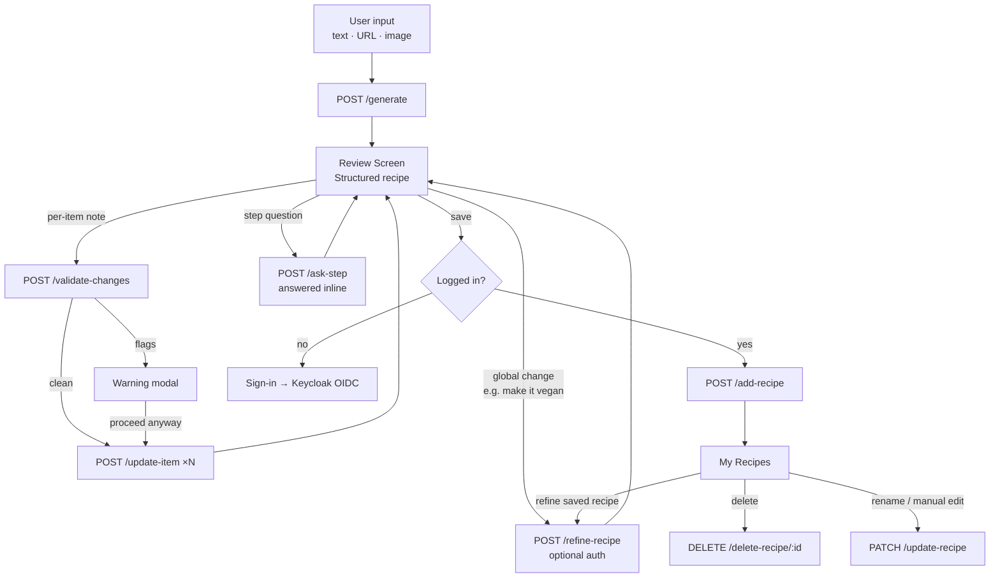
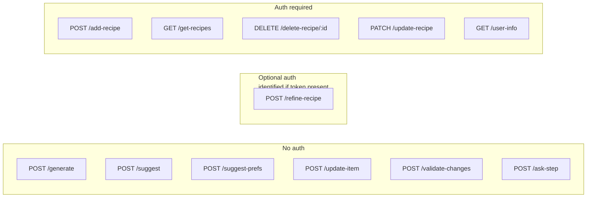

# AGENT.md

This file provides working guidance for the Go backend in this folder.

## Flows

### User journey



### API endpoints by auth requirement



> **Rate limiting hook**: `auth.FromContext(r.Context())` on `/refine-recipe` returns the user if authenticated (limit by user ID) or empty (limit by IP). All other expensive endpoints are either free-tier anonymous or gated behind auth.

## What This Service Does

Recipe API with:
- anonymous recipe generation (text/url/image)
- authenticated recipe CRUD
- Keycloak JWT auth with just-in-time user provisioning
- PostgreSQL persistence

Current infrastructure status:
- Azure is fully removed from code, dependencies, and runtime.
- MinIO/S3 code paths are removed. PostgreSQL is the only persistence layer.

Main entrypoint: cmd/main.go

## Runbook

From this directory:

```bash
# 1) Start local dependencies (Postgres)
docker compose up -d

# 2) Run API
go run ./cmd/

# 3) Build binary
go build -o main ./cmd/

# 4) Run all tests
go test ./...
```

The server listens on :8080.

## Migrations

Migrations are in db/migrations and managed by goose via Makefile targets:

```bash
make migrate-up
make migrate-down
make migrate-status
make migrate-create NAME=my_migration
```

## Required Environment Variables

Minimum required at startup:
- OPENAI_KEY
- DB_URL
- KEYCLOAK_URL

Optional auth tuning:
- KEYCLOAK_CLIENT_SECRET (enables token introspection)
- KEYCLOAK_BACKEND_CLIENT_ID (default: backend)
- KEYCLOAK_AUDIENCE (enables strict audience check)
- AUTH_INTROSPECT=false (disable introspection even when a secret is set)
- CORS_ORIGIN (must match the browser origin exactly, e.g. http://localhost:8081)
- PORT (default: 8080)

## Request Flow and Middleware

Server pipeline in cmd/main.go:
- withCORS
- logRequests
- per-route: authenticator.Require(handler)

Auth behavior (internal/auth):
- Bearer token parsed and verified against Keycloak JWKS (RS256 family only).
- Issuer is checked against KEYCLOAK_URL; audience checked when KEYCLOAK_AUDIENCE is set.
- Introspection runs only when a client secret is configured.
- Just-in-time provisioning: on every authenticated request the `sub` claim is upserted into
  `users.oauth_id` (storage.Users.EnsureUser) and the resulting user id is bound to the request
  context via auth.FromContext. No cloud provisioning, no separate login route.

## API Contract (Current)

Base prefix: /api/v1

Public:
- GET /health
- POST /generate
	- multipart form
	- fields: description (text), url, image

Authenticated (Bearer token required):
- GET /user-info
- GET /get-recipes
- POST /add-recipe
	- JSON: {"recipename":"...","recipe":"...","category":"..."}
	- 201 with the created recipe
- DELETE /delete-recipe/{id}
	- 204 on success
- PATCH /update-recipe
	- JSON: {"id":1,"recipename":"...","recipe":"...","category":"..."}
- POST /update-recipe
	- JSON: {"recipe":"...","changePrompt":"..."}

Notes:
- The historical "service" payload key is gone; the field is "recipe" everywhere.
- Ownership always comes from the token subject, never from the request body.

## Data Model

See DATA_MODEL.md for the canonical schema. Migrations `00001`–`00004` create it from scratch;
there is no legacy database to preserve.

## Code Map

- cmd/main.go: route registration, handlers for user info/recipes/reprompt
- internal/auth: JWKS validation, introspection, JIT user provisioning, typed request context
- internal/service/generate_recipe.go: recipe generation logic (text/url/image), category and naming
- internal/service/handlers.go: generate + add handlers
- internal/storage/db.go: pgx pool and recipe queries
- internal/storage/users.go: EnsureUser upsert keyed by OIDC subject
- internal/model/models.go: request/response structs

## Known Constraints and Pitfalls

- Two OpenAI SDKs are used in parallel:
	- github.com/openai/openai-go
	- github.com/sashabaranov/go-openai
	Keep existing usage consistent unless doing a dedicated migration.

- Unused guard exists:
	- HandlerIsRecipeRelated is not wired to active routes.

- Recipe content is still written as free-form markdown into `recipes.content`.
  `recipe_ingredients` / `recipe_steps` exist but are not populated yet.

- Language detection is prompt-based via lingua-go.

## Editing Guidance

- Prefer small, behavior-preserving changes; this service has production-facing auth and storage side effects.
- When changing endpoints or payload shape, update mobile client calls in recipe-generator-frontend/recipe-generator-mobile/src/services/apiService.ts in the same task.

## Refactor Plans

- API/auth/CRUD plan: ../REFACTOR_PLAN_API_AUTH_CRUD.md
- Backend implementation plan (includes OAS strategy): REFACTOR_PLAN.md
