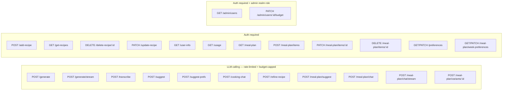

# AGENT.md

This file provides working guidance for the Go backend in this folder.

## Flows

### User journey

```mermaid
flowchart TD
    INPUT[User input\ntext · URL · image] --> GEN[POST /generate]
    GEN --> REVIEW[Review Screen\nStructured recipe + single chat pane]

    REVIEW -->|chat message\ne.g. "remove garlic" · "make it vegan"| REFINE[POST /refine-recipe\noptional auth]
    REFINE --> REVIEW

    REVIEW -->|save| AUTH{Logged in?}
    AUTH -->|yes| SAVE[POST /add-recipe]
    AUTH -->|no| LOGIN[Sign-in → Keycloak OIDC]
    SAVE --> MYRECIPES[My Recipes]

    MYRECIPES -->|refine saved recipe| REFINE
    MYRECIPES -->|delete| DEL[DELETE /delete-recipe/:id]
    MYRECIPES -->|rename / manual edit| PATCH[PATCH /update-recipe]
```

### API endpoints by auth requirement



> **Rate limiting + budget**: all 6 LLM-calling endpoints go through `authenticator.Optional`
> first, so `auth.FromContext(r.Context())` returns the caller if a valid token was sent
> (limit/cap by user ID) or nothing for anonymous callers (limit by client IP, no cost
> tracked at all). Each is wrapped `Optional(rl.Guard(billing.Guard(handler)))` in
> `cmd/main.go`, where `rl` is one of two `internal/ratelimit` limiters:
> `generate`/`transcribe`/`cooking-chat`/`refine-recipe` share one limiter
> (`RATE_LIMIT_ANON_PER_10MIN` / `RATE_LIMIT_AUTH_PER_10MIN`, 429 `rate_limited`);
> `suggest`/`suggest-prefs` share a separate, much more generous one
> (`RATE_LIMIT_SUGGEST_ANON_PER_10MIN` / `RATE_LIMIT_SUGGEST_AUTH_PER_10MIN`) so their
> autocomplete-style calls don't eat into the generation budget. `internal/billing` then
> enforces the caller's monthly spend cap (429 `budget_exceeded`) for authenticated
> callers only — anonymous requests have no cost tracked, so nothing to cap. No other
> `/api/v1` routes are rate-limited or budget-capped.
>
> The 3 `/meal-plan/*` LLM routes share the `generate`/`refine-recipe` limiter and go
> through the same `authenticator.Optional` wrapper as every other LLM route, but —
> unlike those — their handlers explicitly 401 an anonymous caller (they operate on the
> caller's own saved recipes, so there's nothing to suggest from without one). An
> anonymous request still consumes one rate-limit slot before hitting that check.

## What This Service Does

Recipe API with:
- anonymous recipe generation (text/url/image)
- authenticated recipe CRUD
- Keycloak JWT auth with just-in-time user provisioning
- PostgreSQL persistence

Current infrastructure status:
- Azure is fully removed from code, dependencies, and runtime.
- MinIO/S3 code paths are removed. PostgreSQL is the only persistence layer.

Main entrypoint: cmd/main.go

## Runbook

From this directory:

```bash
# 1) Start local dependencies (Postgres)
docker compose up -d

# 2) Run API
go run ./cmd/

# 3) Build binary
go build -o main ./cmd/

# 4) Run all tests
go test ./...
```

The server listens on :8080.

## Migrations

Migrations are in db/migrations and managed by goose via Makefile targets:

```bash
make migrate-up
make migrate-down
make migrate-status
make migrate-create NAME=my_migration
```

## Required Environment Variables

Minimum required at startup:
- OPENAI_KEY
- DB_URL
- KEYCLOAK_URL

Optional auth tuning:
- KEYCLOAK_CLIENT_SECRET (enables token introspection)
- KEYCLOAK_BACKEND_CLIENT_ID (default: backend)
- KEYCLOAK_AUDIENCE (enables strict audience check)
- AUTH_INTROSPECT=false (disable introspection even when a secret is set)
- CORS_ORIGIN (must match the browser origin exactly, e.g. http://localhost:8081)
- PORT (default: 8080)

Optional rate limiting + budget tuning (internal/ratelimit, internal/billing):
- Two separate limiters, both on a rolling 10-minute window: one for the real
  generation endpoints (generate/transcribe/cooking-chat/refine-recipe), one much more
  generous one for suggest/suggest-prefs (cheap autocomplete-style calls a single
  screen fires repeatedly, so they shouldn't eat into the generation budget).
- RATE_LIMIT_ANON_PER_10MIN (default: 5) / RATE_LIMIT_AUTH_PER_10MIN (default: 15) —
  request cap per client IP / per user ID for the generation endpoints.
- RATE_LIMIT_SUGGEST_ANON_PER_10MIN (default: 30) /
  RATE_LIMIT_SUGGEST_AUTH_PER_10MIN (default: 100) — request cap for
  suggest/suggest-prefs.
- LLM_BUDGET_DEFAULT_USD (default: 2.00) — monthly per-user spend cap; overridable per
  user via `users.monthly_budget_usd_override` (`PATCH /admin/users/{id}/budget`).
- LLM_TRANSCRIBE_COST_USD (default: 0.003) — flat per-call cost estimate for
  `/transcribe`; the OpenAI SDK call doesn't return audio duration to price it exactly.

Optional OpenTelemetry metrics (internal/telemetry):
- OTEL_ENABLED — must be `true` to turn metrics on at all; unset/false = no-op, safe default
  for local dev. When true, OTEL_EXPORTER_OTLP_ENDPOINT must also be set (Init errors otherwise).
- OTEL_EXPORTER_OTLP_ENDPOINT, OTEL_EXPORTER_OTLP_PROTOCOL (e.g. `http/protobuf`),
  OTEL_EXPORTER_OTLP_HEADERS (e.g. Grafana Cloud's `Authorization=Basic ...`) — standard OTel
  env vars, read directly by the exporter.
- OTEL_SERVICE_NAME (default: recipe-generator-backend)
- Local stack lives in the sibling `../observability/` folder (otel-collector + Prometheus +
  Grafana), not in this repo's docker-compose.yml: `cd ../observability && docker compose up -d`,
  then run the backend with `OTEL_ENABLED=true OTEL_EXPORTER_OTLP_ENDPOINT=http://localhost:4318
  OTEL_EXPORTER_OTLP_PROTOCOL=http/protobuf`. Grafana: http://localhost:3000 (Prometheus
  datasource pre-provisioned). Same env vars point at Grafana Cloud's OTLP endpoint instead when
  you have one.

## Request Flow and Middleware

Server pipeline in cmd/main.go:
- withCORS
- logRequests
- per-route: authenticator.Require(handler) / authenticator.Optional(handler) /
  authenticator.RequireAdmin(handler); the 6 LLM-calling routes additionally wrap with
  `rl.Guard` (internal/ratelimit) and `billing.Guard` (internal/billing), in that order,
  inside the `Optional` call so both see the identified caller.

Auth behavior (internal/auth):
- Bearer token parsed and verified against Keycloak JWKS (RS256 family only).
- Issuer is checked against KEYCLOAK_URL; audience checked when KEYCLOAK_AUDIENCE is set.
- Introspection runs only when a client secret is configured.
- Just-in-time provisioning: on every authenticated request the `sub` claim is upserted into
  `users.oauth_id` (storage.Users.EnsureUser) and the resulting user id is bound to the request
  context via auth.FromContext. No cloud provisioning, no separate login route.
- `IsAdmin` is set from the token's `realm_access.roles` claim (Keycloak realm role
  `admin`, see `../keycloak/terraform/realm.tf`); `RequireAdmin` wraps `Require` with a
  403 for non-admins.

## API Contract (Current)

Base prefix: /api/v1

Public:
- GET /health

LLM-calling — optional auth (identified if a Bearer token is present, anonymous
otherwise), rate-limited and budget-capped per the "Rate limiting + budget" note above:
- POST /generate
	- multipart form
	- fields: description (text), url, image, language (optional, ISO 639-1, e.g. "en" —
	  client's browser/device locale, used as the default output language when the prompt
	  doesn't carry a clear language signal of its own; see "Language detection" below)
- POST /generate/stream
	- Same multipart form fields as /generate → `text/event-stream` response: one
	  `event: delta` per raw JSON text fragment as the structured recipe is generated
	  (`internal/service.GenerateRecipeStream` → `generateStructuredStream`, which uses
	  `client.Chat.Completions.NewStreaming` same as `StreamMealPlanChatReply`), then one
	  `event: done` carrying the same response shape /generate returns in one shot
	  (`{"recipename":...,"recipe":...,"structured":<RecipeDocument>,"generation_id":...}`),
	  or `event: error` on failure. Shares one rate-limit slot with /generate. Frontend
	  uses this web-only (native `fetch` can't consume a streaming body — same constraint
	  as `meal-plan/chat/stream`) and falls back to plain /generate elsewhere.
- POST /transcribe, POST /suggest, POST /suggest-prefs, POST /cooking-chat
- POST /refine-recipe
	- JSON: `{"origin":{"prompt":"...","source_type":"text|url|image","source_url":"..."},`
	  `"initial":<RecipeDocument>,"history":[{"change_prompt":"...","structured":<RecipeDocument>}],`
	  `"change_prompt":"..."}`
	- Threads the whole conversation (original ask → initial doc → every prior accepted
	  edit → the new instruction) into one multi-turn LLM call, so each edit stays
	  consistent with everything before it. `history` is the edits since `initial`,
	  oldest first — it does NOT include `initial` itself.
- POST /meal-plan/suggest
	- JSON: `{"starts_on":"2026-09-07","ends_on":"2026-09-13"}` → 200 `MealPlanSuggestion`:
	  `{"status":"applied"|"needs_clarification","message":"..."|null,"low_variety":bool,`
	  `"assignments":[{"recipe_id":7|null,"variant":<RecipeDocument>|null,`
	  `"variant_of_recipe_id":7|null,"planned_on":"...","start_time":"..."}, ...]}`.
	  Selects from the caller's saved recipes only (`storage.GetRecipes`, plus soft signal
	  from `storage.GetCookingProfile`/`GetPreferences`, the latter merged with any
	  per-week override from `GetWeekPreferences` for the requested range — see
	  `GET`/`PATCH /meal-plan/week-preferences` below). The merged prefs include
	  `meal_plan_no_food_days` (skip entirely, no assignment) and `meal_plan_no_cook_days`
	  (still eats — repeat the most recent prior cooked day's dish, a leftover day) —
	  migrations `00015`/`00016` — plus `meal_plan_batch_days` (repeat a recipe across N
	  consecutive days). A no-cook day at the very start of the range can carry forward a
	  dish cooked just before the week boundary (e.g. "cook Sunday for Monday") via a
	  "most recently cooked meal" context line the handler builds from the 3 days
	  preceding `starts_on`. One assignment per day in the range, exactly one of
	  `recipe_id`/`variant` set per assignment. `low_variety:true` (fewer than 10 saved
	  recipes) permits up to 2 `variant` days: a newly generated recipe (not yet saved)
	  proposed as a twist on an existing one. Despite the shared `authenticator.Optional`
	  wrapper, this 401s an anonymous caller (see the note above).
- POST /meal-plan/chat
	- JSON: `{"starts_on":"...","ends_on":"...","initial":<MealPlanSuggestion>,`
	  `"history":[{"message":"...","plan":<MealPlanSuggestion>}, ...],"message":"..."}` →
	  200 `MealPlanSuggestion`. Stateless, same shape as `/refine-recipe`: the caller
	  resends `initial` (the first `/meal-plan/suggest` result) and every turn since, the
	  server never persists chat state. Unlike `/meal-plan/suggest`, `variant` generation
	  here is **not** gated by `low_variety` — a chat message is a bounded, explicit edit
	  request against one day, so an ingredient/protein swap ("change shrimp to beef")
	  always has a legal way to become a targeted `variant` of that day's current dish
	  instead of the model substituting an unrelated saved recipe by closest title (the
	  bug this fixed). The handler also grounds the edit by fetching the full ingredient
	  list for every `recipe_id` currently in `initial.assignments` (bounded to that
	  plan's ≤7 days), not just the titles `buildMealPlanContextText` normally sends.
- POST /meal-plan/chat/stream
	- JSON: `{"starts_on":"...","ends_on":"...","message":"..."}` → `text/event-stream`
	  response: one `event: message` per text delta (`data:` is the JSON-encoded chunk
	  string), then `event: done`, or `event: error` on failure. A short conversational
	  acknowledgment only (`assistModel`, plain text, no JSON schema) — the frontend calls
	  this in parallel with `POST /meal-plan/chat` for the actual plan update; this
	  endpoint exists purely so the chat feels alive while that heavier call runs.
	  `internal/service.StreamMealPlanChatReply` uses
	  `client.Chat.Completions.NewStreaming`. `cmd/main.go`'s `statusRecorder` implements
	  `http.Flusher` (forwarding to the underlying writer) specifically so this streams
	  progressively through `logRequests`/`otelhttp` instead of buffering.
- POST /meal-plan/variants/{recipe_id}
	- optional JSON `{"hint":"make it Thai-style"}` → 200
	  `{"recipename":"...","recipe":"...","structured":<RecipeDocument>,"variant_of_recipe_id":7}`
	  — a new, **unsaved** recipe proposed as a twist on `recipe_id` (which must belong to
	  the caller and have structured data). Persist it via `POST /add-recipe` with
	  `variant_of_recipe_id` set only if the caller accepts it. 404 if the recipe isn't
	  found/owned; 422 if it has no structured data to vary.

Authenticated (Bearer token required):
- GET /user-info
- GET /get-recipes
- POST /add-recipe
	- JSON: `{"recipename":"...","recipe":"...","tags":["..."],"structured":<RecipeDocument>,`
	  `"origin":{...},"history":[{"change_prompt":"","structured":<RecipeDocument>}, ...],`
	  `"variant_of_recipe_id":7}`
	- `variant_of_recipe_id` is optional — set when persisting a `POST
	  /meal-plan/variants/{id}` result the caller accepted; stored on `recipes` for
	  grouping, not otherwise surfaced yet.
	- `origin`/`history` are optional. When present (structured saves only), `history[0]`
	  is the initial generation (`change_prompt: ""`); each entry becomes a
	  `recipe_versions` row (`change_kind` `'extraction'` then `'ai_edit'`, `change_note`
	  = the instruction) and a matching `recipe_timeline_events` row, and `origin` is
	  recorded as a `sources` row. `current_version` ends up `len(history)` — so
	  `current_version == 1` means "saved the first generation unedited."
	- 201 with the created recipe
- DELETE /delete-recipe/{id}
	- 204 on success
- PATCH /update-recipe
	- JSON: `{"id":1,"structured":<RecipeDocument>,"ai_sourced":false,"change_prompt":""}` —
	  overwrites the recipe's header, ingredients, steps, and tags with `structured` (tags
	  are always fully replaced, no more "empty tags = unchanged"). `ai_sourced` defaults to
	  `false`; when `false` the recipe is flagged `manually_edited = true`, when `true`
	  (persisting an applied `/refine-recipe` result) the flag is cleared to `false`. Every
	  call also appends one `recipe_versions` snapshot (`change_kind` `'manual'` or
	  `'ai_edit'` to match) and a matching `recipe_timeline_events` row, bumping
	  `current_version` — so a saved recipe's edit trail keeps growing after the initial
	  save, not just during it. `change_prompt` is optional and becomes that version's
	  `change_note`; it's the natural way to persist the AI instruction behind an
	  `ai_sourced` update.
- POST /update-recipe
	- JSON: {"recipe":"...","changePrompt":"..."}
- GET /recipes/{id}/history
	- 200 with `[<RecipeVersion>, ...]`, newest first:
	  `{"version":2,"change_kind":"ai_edit","change_note":"make it vegan","created_at":"...",`
	  `"data":<RecipeDocument>}`. `change_note` is omitted for `"manual"`/`"extraction"`
	  entries with no note. A recipe that's never had a structured save (markdown-only
	  `add-recipe`, no `structured` field) returns `[]`. 404 if the recipe doesn't exist or
	  isn't owned by the caller.
- GET /usage
	- 200 with `{"spent_usd":...,"cap_usd":...,"period_start":"2026-09-01T00:00:00Z","pct_used":...}`
	  — the caller's own current-calendar-month LLM spend and effective budget cap (their
	  `monthly_budget_usd_override` if set, else `LLM_BUDGET_DEFAULT_USD`). Poll this to
	  show an 80%/100% warning before the caller hits the `budget_exceeded` 429 below.
- GET /meal-plan?starts_on=YYYY-MM-DD&ends_on=YYYY-MM-DD
	- `starts_on` required; `ends_on` optional, defaults to `starts_on+6d` (a week). Range
	  capped at 42 days; 400 if missing/unparseable/out of range.
	- 200 with `{"starts_on":"...","ends_on":"...","items":[{"id":...,"recipe_id":...,`
	  `"recipe_title":"...","planned_on":"...","start_time":"18:00:00"}, ...]}` — every
	  item planned in that range, one recipe per day (`meal_slot` stays at its DB default
	  `'dinner'`; not yet exposed via the API). Used by all three calendar views: Week
	  passes a 7-day range, Day a single day, Month the full displayed grid (up to 42
	  days).
- POST /meal-plan/items
	- JSON: `{"recipe_id":7,"planned_on":"2026-09-09","start_time":"18:00:00"}` →
	  201 with the created item (same shape as one entry in `GET /meal-plan`'s `items`).
	  `start_time` optional, defaults to `18:00:00`. 404 if `recipe_id` doesn't belong to
	  the caller. Upserts by day — replaces whatever was already assigned to `planned_on`,
	  so reassigning a filled day needs no separate delete. Creates that week's
	  `meal_plans` row implicitly on first use.
- PATCH /meal-plan/items/{id}
	- JSON: `{"planned_on":"2026-09-10","start_time":"08:30:00"}` (both required, full
	  replace) → 200 with the updated item. Moves an item to a new day and/or time — the
	  Day view's drag interaction. 404 if the item doesn't exist or isn't owned by the
	  caller.
- DELETE /meal-plan/items/{id}
	- 204 on success, 404 if the item doesn't exist or isn't owned by the caller.
- GET /preferences
	- 200 with `UserPreferences`: `{"skill_level":...,"dietary_prefs":[...],`
	  `"disliked_ingredients":[...],"cooking_cadence":...,"meal_plan_no_food_days":[...],`
	  `"meal_plan_no_cook_days":[...],"meal_plan_batch_days":1,"week_start_day":"monday"}`.
- PATCH /preferences
	- JSON: full `UserPreferences` (server overwrites, not a merge — always send the
	  complete object). `meal_plan_no_food_days`/`meal_plan_no_cook_days`/
	  `week_start_day` entries validated against `weekdayNames`; `meal_plan_batch_days`
	  must be 1/2/3. → 200 with the saved object.
- GET /meal-plan/week-preferences?starts_on=YYYY-MM-DD
	- 200 with `MealPlanWeekPreferences`: `{"no_food_days":[...]|null,`
	  `"no_cook_days":[...]|null,"batch_days":1|2|3|null}` — the per-week override for
	  the week (per the caller's `week_start_day`) containing `starts_on`. `null` on a
	  field means "inherit the global `/preferences` default"; a week with no override
	  row yet returns all-null.
- PATCH /meal-plan/week-preferences?starts_on=YYYY-MM-DD
	- JSON: full `MealPlanWeekPreferences`, same full-replace/null-means-inherit
	  convention as `PATCH /preferences`. Creates that week's `meal_plans` row implicitly
	  on first use (`storage.UpdateWeekPreferences`) → 200 with the saved object.

Admin (Bearer token required + `admin` realm role — `internal/auth.RequireAdmin`, 403 for
non-admins):
- GET /admin/users
	- 200 with `[{"id":...,"email":"...","name":"...","spent_usd":...,"cap_usd":...,`
	  `"override_usd":...,"last_seen_at":"..."}, ...]` for every user, most-spent first.
	  `override_usd` is omitted when the user has no override (effective cap is the default).
- PATCH /admin/users/{id}/budget
	- JSON: `{"monthly_budget_usd": 10.0}` (or `null` to clear the override and fall back
	  to the default cap) → 204. 404 if the user doesn't exist.

Notes:
- LLM-calling endpoints return `429` with `{"error":"rate_limited"}` (request cap hit —
  `Retry-After` header included) or `{"error":"budget_exceeded"}` (authenticated caller
  hit their monthly cap) — distinct `error` values so the frontend can tell them apart.
- The historical "service" payload key is gone; the field is "recipe" everywhere.
- Refining/saving an already-saved recipe (CookingModeScreen, "cooking notes" flow) does
  not use `origin`/`history` — that path stays a single-turn refine with no persisted
  edit trail. Only the pre-save GenerateScreen review chat does.
- Ownership always comes from the token subject, never from the request body.

## Data Model

See DATA_MODEL.md for the canonical schema and RECIPE_TAGS.md for the tagging taxonomy.
Migrations `00001`–`00006` create it from scratch; there is no legacy database to preserve.

## Code Map

- cmd/main.go: route registration, handlers for user info/recipes/usage/admin
- cmd/mealplan.go: meal-plan handlers (range get / add / patch / delete item, AI suggest/chat/variants)
- internal/auth: JWKS validation, introspection, JIT user provisioning, admin role, typed request context
- internal/ratelimit: in-memory per-IP/per-user token-bucket request limiter
- internal/billing: LLM cost estimation (pricing.go) and monthly budget enforcement (guard.go)
- internal/service/generate_recipe.go: recipe generation logic (text/url/image), tags and naming
- internal/service/mealplan.go: meal-plan suggestion/chat prompt-building + LLM calls, recipe variant generation — mirrors generate_recipe.go's structured-output pattern
- internal/service/tags.go: fixed recipe tagging vocabulary (`AllTagSlugs`), see specs/RECIPE_TAGS.md
- internal/service/handlers.go: generate + add handlers, shared LLM cost-recording helper
- internal/storage/db.go: pgx pool and recipe queries
- internal/storage/users.go: EnsureUser upsert keyed by OIDC subject
- internal/storage/usage.go: LLM usage recording, spend lookup, admin usage listing, budget overrides
- internal/storage/mealplan.go: meal-plan range queries, upsert-by-day add, move (patch), delete
- internal/model/models.go: request/response structs

## Known Constraints and Pitfalls

- Two OpenAI SDKs are used in parallel:
	- github.com/openai/openai-go
	- github.com/sashabaranov/go-openai
	Keep existing usage consistent unless doing a dedicated migration.

- Unused guard exists:
	- HandlerIsRecipeRelated is not wired to active routes.

- Recipe content is written as free-form markdown into `recipes.content` (still the field
  the mobile client renders), but for structured saves (`storage.AddRecipeStructured`)
  `recipe_ingredients` / `recipe_steps` / `recipe_versions` / `recipe_timeline_events` /
  `sources` are all populated too — only the plain-markdown `storage.AddRecipe` path
  (no `structured` field) skips them.

- Language detection (text-generation path only): `resolveLanguage` in `generate_recipe.go`
  trusts `lingua-go` detection only when the prompt is at least 4 words (a short foreign dish
  name shouldn't override the client's browser locale); otherwise it falls back to the
  `language` form field sent by the client, or to `""` (LLM self-detects) for older clients that
  don't send it.

- **Introspection requires an audience mapper on every client whose tokens reach this
  backend.** Keycloak 26.x's `/protocol/openid-connect/token/introspect` returns
  `{"active": false}` — not an error — for a perfectly valid, unexpired token if the
  introspecting client (`KEYCLOAK_BACKEND_CLIENT_ID`, i.e. `backend`) isn't present in
  the token's `aud` claim. `frontend` didn't have `backend` in its audience until an
  explicit audience mapper was added (Terraform-managed, see
  `../keycloak/terraform/`). If a new client is ever added (another app, a service,
  etc.) and its calls to auth-required endpoints get an immediate, consistent 401 with
  `introspection done active=false` in the logs — not something that only happens after
  time passes — this is almost certainly the cause: add the same audience mapper for
  that client.

## Editing Guidance

- Prefer small, behavior-preserving changes; this service has production-facing auth and storage side effects.
- When changing endpoints or payload shape, update mobile client calls in recipe-generator-frontend/recipe-generator-mobile/src/services/apiService.ts in the same task.

## Refactor Plans

- API/auth/CRUD plan: ../REFACTOR_PLAN_API_AUTH_CRUD.md
- Backend implementation plan (includes OAS strategy): REFACTOR_PLAN.md
